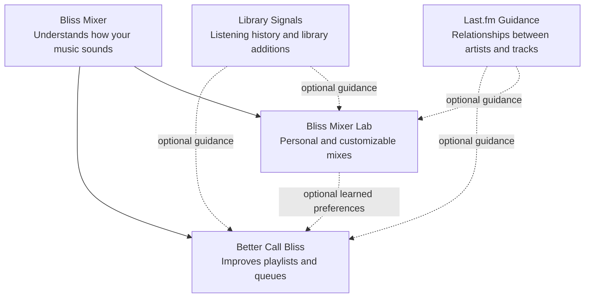
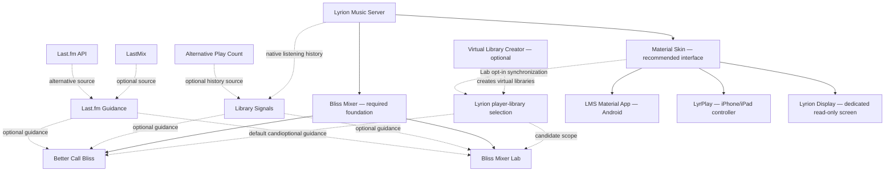
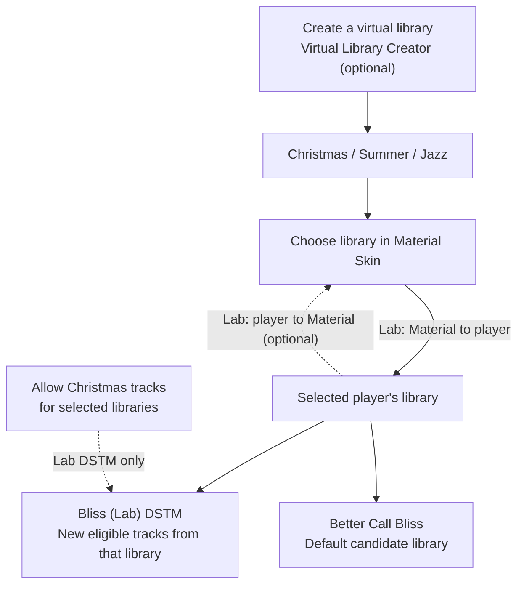

# Concept for the Lyrion Plugins User Guide

**Status:** Concept and implementation baseline for review — 26 November 2026 (expanded with lightweight, portable and private listening, related plugins and recommended client apps)

## 1. Purpose and review of existing documentation

Position the Wiki as a **practical, scenario-driven user guide for Lyrion Music Server users**, rather than an extension of the technical documentation in the individual repositories.

The central question:

> What can these plugins do to improve my everyday music-listening experience, and how can I use them to achieve that?

Users should discover capabilities without already knowing which plugin provides them, how Bliss works internally, or what a guidance provider is.

### Existing documentation

| Repository | Existing documentation |
| --- | --- |
| [LMS Plugins](https://github.com/chrober/lms-plugins) | Collection overview, plugin selection, dependencies and installation |
| [Better Call Bliss](https://github.com/chrober/lms-better-call-bliss) | Playlist optimization, bridging, extension, queue manipulation and musical journeys |
| [Bliss Mixer Lab](https://github.com/chrober/lms-blissmixer-lab) | Personalized mixing, DSTM, artist repeat policies, virtual libraries and alternative mixing actions |
| [Library Signals](https://github.com/chrober/lms-guidance-library-signals) | Rediscovery, listening history, play counts and recent library additions |
| [Last.fm Guidance](https://github.com/chrober/lms-guidance-lastfm) | Related tracks and artists, additional mixing guidance and offline listening |

The READMEs, particularly their “What can I do with it?” sections, provide a strong foundation. However, they are naturally organized around individual plugins. A user interested in rediscovering music in a large collection must already understand the relationship between Bliss Mixer Lab and Library Signals to locate the relevant information.

| Existing READMEs | Proposed Wiki |
| --- | --- |
| Plugin-oriented | Listening-scenario-oriented |
| What does this plugin do? | What do I want to achieve? |
| Individual features | Practical outcomes |
| Individual plugin configuration | Combined plugin usage |
| Technical requirements | Guided setup |
| Architecture and implementation | Illustrative everyday examples |

Retain the READMEs largely as they are; the Wiki is a complementary, cross-plugin documentation layer.

Beyond musical features, the Wiki should communicate the benefits of owning and controlling a local music system: modest hardware requirements, portable listening, independence from internet connectivity, and the option to keep music selection and listening history private. These are benefits of the wider Lyrion and Bliss ecosystem, complemented by the plugins in this collection.

[Lyrion Display](https://github.com/chrober/lyrion-display) is a related, independent Android app that complements the listening experience with a dedicated Now Playing display. It belongs in the Wiki as a peripheral topic, not as another plugin in the collection or an additional editorial pillar. Its own README remains the source for installation, compatibility and support. The Wiki should also acknowledge the wider Lyrion ecosystem, explain the required and optional third-party plugins, and recommend suitable clients for Android and Apple devices. These are curated recommendations relevant to the documented scenarios, not an attempt to catalogue every Lyrion extension.

## 2. Proposed information architecture

Use a hybrid architecture with **usage scenarios as primary navigation** and individual plugin descriptions as secondary reference material. Readers should not need to understand the ecosystem before discovering its benefits.

- **Home** — welcome and discover what is possible.
- **Getting started**
  - Understanding Bliss and its extensions
  - Which plugins do I need?
  - Build your Lyrion setup (required, recommended and optional plugins; recommended client apps)
  - Installation and first steps
- **Make more of your playlists**
  - Make your playlists flow better
  - Smooth transitions without changing the order
  - Turn a short playlist into a long listening session
  - Improve your current player queue
  - Take a musical journey to a song or album
- **Keep the music playing**
  - A different Don't Stop the Music experience
  - Teach Bliss your musical preferences
  - Avoid repetitive mixes
  - Music for every season, mood and moment (virtual libraries and player-library synchronization)
- **Rediscover your music collection**
  - Rediscover forgotten favorites
  - Give rarely played music a chance
  - Discover your recently added albums
  - Rediscover related artists and songs
- **Combine plugins for a better experience**
  - Personalized playlists and mixes
  - Combining listening history and Last.fm
  - Music discovery without internet access
- **Your music, anywhere, under your control**
  - A lightweight music server on a Raspberry Pi
  - Take your music collection travelling
  - Listen without an internet connection
  - Keep your listening habits private at home
  - Prepare optional Last.fm information for offline use
- **Plugin reference**
  - Better Call Bliss
  - Bliss Mixer Lab
  - Bliss Guidance: Library Signals
  - Bliss Guidance: Last.fm
- **Help and frequently asked questions**
  - Common questions and troubleshooting
- **Related projects** (a small sidebar section)
  - [Lyrion Display](https://github.com/chrober/lyrion-display) — a dedicated Now Playing display for your Lyrion music system
  - Build your Lyrion setup — links to relevant third-party plugins and recommended mobile clients

This is the logical structure, not necessarily a one-page-per-entry plan. Closely related scenarios can initially share a page to keep the Wiki manageable.

## 3. Wiki home page

The home page could also serve as a landing page for visitors from the Lyrion community forum. Introduce four musical reasons to explore the collection rather than immediately introducing four plugins, followed by a cross-cutting benefit: local, portable and private listening.

### Proposed home-page copy

> # Get more out of your music collection
>
> Music is more than a collection of albums and tracks. These extensions for Lyrion Music Server help you create better playlists, enjoy more personal mixes and rediscover music you already own.
>
> **Make your playlists flow**
>
> Turn a collection of favorite songs into a coherent listening experience, with smoother transitions and suitable additions.
>
> **Keep the music playing**
>
> Enjoy continuous mixes that reflect your musical preferences, without having to decide what to play next. Switch to a collection that suits your mood — Christmas music in December, surf rock on a summer afternoon, or quiet jazz after dinner — and let the music keep playing within it.
>
> **Rediscover the music you own**
>
> Hear forgotten favorites, overlooked albums and recent additions instead of always returning to the same songs.
>
> **Explore musical connections**
>
> Discover relationships between tracks and artists beyond their acoustic similarities.
>
> **Your music, anywhere, under your control**
>
> Run your music server on a small Raspberry Pi, take it with you when travelling, or enjoy music at home without relying on online recommendation services. Your local music collection, Bliss analysis and listening history can stay with you. Even without internet access, you can create mixes, improve playlists and rediscover music you already own.
>
> **See what's playing**
>
> As an optional companion, [Lyrion Display](https://github.com/chrober/lyrion-display) turns a compatible Fire TV, Android TV or Android tablet into a dedicated Now Playing display for your Lyrion system.
>
> **New here?** Start with *Which plugins do I need?*

For the actual Wiki, use genuine plugin screenshots and purpose-built illustrations rather than generic stock photography. The home page's getting-started link should lead to a clear overview of required, recommended and optional plugins and suitable Android/Apple clients; avoid listing all dependencies on the landing page.

## 4. Explain the Bliss ecosystem in simple language

Dedicate a page to why the plugins are separate and how they interact with CDrummond's original [Bliss Mixer](https://github.com/CDrummond/lms-blissmixer).



The guidance connections apply to supported workflows, notably Bliss (Lab) DSTM and Better Call Bliss optimization. Keep the main music-selection diagram simple; use a second ecosystem diagram or the Getting Started overview to show external dependencies and client options.

### Wider ecosystem: data sources and user interfaces



Material Skin is a user interface, not a component of the music-selection algorithm. The client apps are alternatives or companions, not mandatory components of the collection. Material Skin is specifically required for Better Call Bliss's destination shortcuts, Lab's Material-specific player-library integration and Lyrion Display, and for the Material-based mobile interfaces shown here. LyrPlay is recommended here primarily as the Apple alternative to LMS Material App for browsing music and controlling existing Lyrion players. Its integrated audio player is an additional capability, not the reason for this recommendation.

Suggested explanation:

> Bliss Mixer understands how your music sounds.
>
> Better Call Bliss uses this knowledge to improve your playlists and player queues.
>
> Bliss Mixer Lab uses it to explore new ways of creating mixes, including mixes that reflect your personal taste.
>
> Library Signals adds knowledge about your listening habits, while Last.fm Guidance adds knowledge about musical relationships.
>
> You can choose the extensions that suit your listening habits. You don't need to install all of them.

Explain the **Bliss-first principle** in everyday language: additional information helps choose between musically suitable songs rather than replacing acoustic similarity. No discussion of Rust engines, native binaries, databases, scoring algorithms or provider interfaces is needed here.

### Optional companion: the visual listening experience

Lyrion Display is independent of the Bliss ecosystem. It connects to Lyrion Music Server and presents Craig Drummond's existing Material Skin fullscreen Now Playing view. It neither selects music nor controls playback. A conceptual listening-experience diagram may show the music server providing playback to existing Lyrion players and, separately, Now Playing information through Material Skin to Lyrion Display. Do not draw a direct functional dependency from any Bliss extension to the app.

## 5. Usage scenario catalogue

Some scenarios below are explicitly described in the READMEs; others are practical applications of documented features. The original Bliss Mixer and its completed library analysis are assumed throughout.

### Playlists and listening sessions

| Scenario | Benefit | Plugin |
| --- | --- | --- |
| My favorite songs don't flow well together | Reorder tracks for smoother transitions | Better Call Bliss |
| I don't want to change my carefully curated playlist | Add suitable bridging tracks | Better Call Bliss |
| I'm hosting a dinner party | Extend a short playlist to last the entire evening | Better Call Bliss |
| I'm not happy with what's coming up next | Improve upcoming tracks without interrupting the current song | Better Call Bliss |
| I want to hear a particular album next | Create a musical journey to the album | Better Call Bliss |
| I want to take a musical detour | Visit another song or album and return to the original queue | Better Call Bliss |

### Continuous and personalized listening

| Scenario | Benefit | Plugin |
| --- | --- | --- |
| I don't want to constantly choose what plays next | Automatic continuation with Bliss (Lab) | Bliss Mixer Lab |
| Bliss doesn't always understand what I consider similar | Learn personal musical preferences | Bliss Mixer Lab |
| The same artists appear too frequently | More precise artist repeat handling | Bliss Mixer Lab |
| It's December — let's get into the Christmas spirit | Select a Christmas virtual library and permit Christmas tracks in Bliss (Lab) DSTM | Bliss Mixer Lab + Material Skin; Virtual Library Creator recommended |
| The sun is out — give me surf rock and summer sounds | Switch the selected player's library to a summer collection and keep the mix within it | Bliss Mixer Lab + Material Skin; Virtual Library Creator recommended |
| I want music that fits my mood or the room | Pick a thematic player library and restrict new DSTM selections or playlist additions to that collection | Bliss Mixer Lab + Material Skin; optionally Better Call Bliss |

### Featured scenario — Music for every season, mood and moment

> “It's snowing outside, the lights are on, and I'm in the mood for Christmas music. I don't want to put together another playlist — I just want the music to keep playing.”

Give this scenario a prominent subsection in **Keep the Music Playing**, with cross-links from playlist extension, personalization and Getting Started. The benefit is switching the musical world of a player in a single place, rather than merely filtering what a single browser can display.

A virtual library is a named view of a subset of your existing music collection. The audio files stay where they are, and the same song can belong to several virtual libraries. [Virtual Library Creator](https://github.com/AF-1/lms-virtuallibrarycreator) by AF-1 makes it easy to create and manage these collections in a browser using selection criteria. It is strongly recommended for this scenario, but not required if the desired virtual libraries already exist.

| Listening moment | Example virtual library | What you could do |
| --- | --- | --- |
| The first snow has arrived | Christmas | Start a festive song and let Bliss (Lab) DSTM continue within your Christmas collection. |
| A sunny afternoon with the windows open | Summer / Surf Rock | Switch to a collection of surf rock, sunshine pop and other suitably tagged summer music. |
| Coffee, rain and a quiet Sunday morning | Sunday Jazz | Keep the automatic mix within your selected jazz collection. |
| Friends are coming over for dinner | Dinner & Lounge | Select a collection of suitable music, extend a short dinner playlist with Better Call Bliss, or let DSTM continue the session. |
| It's time for a workout | Workout Rock | Keep new selections in the player's energetic rock collection. |
| Everyone has a different taste | Living Room / Kids' Room | Assign different collections to different players rather than imposing a single browsing filter on the whole household. |

These are examples of user-created collections, not built-in mood detection, automatic seasonal scheduling or ready-made virtual libraries. Membership depends on the rules and metadata used to create each library.

**What you need:** Lyrion, an installed and analyzed Bliss Mixer library, Bliss Mixer Lab, Material Skin and at least one virtual library. Virtual Library Creator is recommended to define the collections conveniently. Better Call Bliss is optional for playlist and route workflows.

**How to set it up**

1. In **Extras → Virtual Library Creator**, create a named virtual library, for example **Christmas**, using suitable criteria such as genres or tags available in your collection. Enable it and let Lyrion finish creating it.
2. In Material Skin, disable its own **Adjust player library** option to avoid conflicts with Lab's synchronization.
3. In Bliss Mixer Lab settings, under **Material player-library synchronization**, enable **Use Material's library selection as the selected player's library**. For the reverse direction, also enable **Show the selected player's library in Material** if you want Material clients to follow the selected player's current library.
4. Save the settings and reload each Material client. Select the intended player, then choose the desired virtual library in Material's library picker.
5. For Christmas, under **Allow Christmas tracks in selected virtual libraries**, check the Christmas library if Bliss Mixer's Christmas exclusion would otherwise block those tracks. This exception is specifically for **Bliss (Lab)** DSTM, not a global override or an override for Better Call Bliss.
6. Start a suitable track from the library and choose **Bliss (Lab)** as the Don't Stop the Music provider. When new music is needed, the mix selects new eligible tracks within the player's virtual library.

**Why the synchronization matters**

A library filter in Material is not necessarily the same thing as the virtual library assigned to a Lyrion player. With Lab's opt-in synchronization, picking a library in Material can change the selected player's actual library setting. Player-library-aware features then use that setting, rather than being limited to what happens in the current browser. With reverse synchronization enabled, Material can also follow the player's library. Other controllers need their own support to reflect library changes.



**What to expect**

- Bliss (Lab) DSTM restricts new candidates to the assigned player library; acoustic suitability, repeat constraints and other configured filters remain active. The Christmas exception only suspends the Christmas exclusion for the chosen libraries in Lab DSTM.
- Better Call Bliss can use the player library as its default candidate scope when opening the editor or resolving a route context, subject to explicit candidate-library selections. For a summer playlist, for instance, choose the Summer library and preview additions drawn from it. Existing source tracks and explicitly chosen destinations are distinct from new candidate tracks; do not imply that changing the library automatically purges or rewrites a queue or playlist.
- The player-library setting affects the player and other features that respect it, not just the current Material browser. It does not force every controller or every third-party mixer to support it.
- Changing the library is not a request to interrupt playback or replace the already queued songs. Use a suitable seed/current queue and allow subsequent DSTM selections to follow the new scope. Return to the full library when you want unrestricted listening.
- The Christmas exception is optional, library-specific and not calendar-driven. If no eligible candidates remain, the library or other filters may need adjustment.

**Visual plan:** show the Virtual Library Creator editor, the two Lab synchronization options and the Christmas exception list, followed by Material's library picker before and after selecting a themed library. Use a real example and demonstrate DSTM or a Better Call Bliss preview, clearly identifying new candidate tracks rather than implying all existing queue entries are filtered.

Credit AF-1 for Virtual Library Creator and Craig Drummond for Material Skin and Bliss Mixer. This scenario combines their existing functionality with the Lab's synchronization and library-specific Christmas handling and the collection's library-aware music-selection workflows.

### Music rediscovery

| Scenario | Benefit | Plugin combination |
| --- | --- | --- |
| I haven't heard some of my favorite songs in years | Prefer long-unheard tracks | Lab + Library Signals |
| My mixes always contain the same familiar songs | Give less-played tracks more opportunities | Lab + Library Signals |
| I recently added several new albums | Give recent additions more attention | Lab + Library Signals |
| I want a mix of my familiar favorites | Favor frequently played tracks | Lab + Library Signals |
| I want an existing playlist to help me rediscover music | Guide playlist additions using listening history | Better Call Bliss + Library Signals |

### Musical relationships and combined experiences

| Scenario | Benefit | Plugin combination |
| --- | --- | --- |
| Acoustic similarity alone isn't enough for me | Include Last.fm musical relationships | Either host + Last.fm |
| I want to rediscover related artists I already own | Favor musically suitable, related artists | Lab + Last.fm |
| I want playlists that reflect my personal taste | Use learned preferences in playlist optimization | Better Call Bliss + Lab |
| I want related but overlooked music | Combine Last.fm relationships and listening history | Either host + both providers |
| I take my music server on holiday | Prepare artist relationships for offline-friendly listening | Either host + Last.fm |

The combined scenarios are particularly valuable because they communicate the benefits of the ecosystem as a whole.

### Lightweight, portable and private listening

| Scenario | Benefit | What makes it possible |
| --- | --- | --- |
| I don't want to keep a large computer running just to listen to music | A compact, low-resource local music server | Lyrion + Bliss Mixer; compatible collection plugins |
| I want to take my music collection on holiday or on a camping trip | Bring the server, local music and prepared analysis with you | Lyrion + Bliss Mixer; optional Better Call Bliss and Lab |
| I have unreliable or no internet access | Keep mixing, optimizing playlists and rediscovering locally available tracks | Local Bliss analysis, local music, optional learned preferences and Library Signals |
| I prefer not to send my listening habits or music queries to online services | Use local music selection and local listening history on an internet-isolated setup | Lyrion + Bliss Mixer; optional Library Signals and Lab; no live online guidance |
| I want some Last.fm knowledge available while travelling | Prepare and reuse locally stored artist relationships | Last.fm Guidance with API Key source; Offline preferred; compatible host |

### Dedicated article: Your music, anywhere, under your control

> “I want a small music server that I can take with me, and I don't want my music experience to depend on having an internet connection.”

This is a distinct user benefit, not merely a technical requirement or another Last.fm feature. It merits a dedicated page, cross-linked from Getting Started, Rediscover Your Music, Explore Musical Connections and the home page.

**A small music server, not a cloud service.** A Raspberry Pi 4 is the author's actual development and test platform and a practical example of the modest hardware on which the collection can run. Avoid universal performance guarantees or quantified resource claims without measurements; library size, initial analysis, optimization workload and storage affect performance.

**Take your music along.** A portable setup could consist of a Raspberry Pi, a power supply, a local music drive or other storage accessible without the internet, and a player/controller on a local network. Illustrate everyday examples such as a holiday apartment, campervan or remote location. A local network can work without an internet connection; internet isolation does not necessarily mean disconnecting the player and server from one another.

**Keep your music knowledge with you.** Once the local library has been prepared, Bliss acoustic analysis, Lyrion play counts and last-played information, library-addition dates and optional learned preferences can remain locally available. The collection's playlist and mixing capabilities can operate on those local resources. Library Signals adds music rediscovery without requiring an external recommendation service.

**Privacy at home.** The same setup can deliberately be isolated from the internet, rather than merely being offline while travelling. Local analysis and locally guided selection do not inherently require sending track or artist queries to a recommendation service. Avoid claiming that every LMS feature, third-party plugin or controller is network-free: online metadata, scrobbling, streaming, updates and Last.fm queries may use the internet depending on configuration. For a firm no-internet guarantee, enforce isolation at the network level and use locally available media. A LAN-only setup is not necessarily a strict physical air gap; explain that distinction without unnecessary networking jargon.

**Optional Last.fm preparation.** Last.fm Guidance can acquire artist relationships while connected, using its API Key source, and retain them locally for later use. Offline preferred can reuse stored artist information and degrade gracefully when the network is unavailable. Track relationships use a separate short-lived cache, so not all track information will necessarily be available offline. Offline preferred is not a strict offline-only setting: it may still make online requests if connectivity is available. For an internet-isolated setup, rely on actual network isolation (or leave Last.fm guidance disabled if no external data is wanted). Be explicit that initial acquisition sends requests to Last.fm; storing the results locally does not undo those earlier requests. Keep the distinction between fully local analysis/history and previously downloaded external knowledge.

**Before you leave home:** install and configure the required plugins, complete the Bliss analysis, ensure the music files are accessible offline, optionally train the preference survey and download Last.fm artist information, and test playback and mixing with internet access disconnected. Updates or downloads can be performed during a separate connected maintenance session if desired.

**Give credit where it belongs.** Local music hosting and local playback are Lyrion capabilities. Local acoustic analysis and the foundation for Bliss-based music selection come from [Bliss Mixer by Craig Drummond](https://github.com/CDrummond/lms-blissmixer) and the underlying Bliss technology. The plugins in this collection build on that foundation: Better Call Bliss adds local playlist and queue transformations; Bliss Mixer Lab adds experimental mixing and optional learned preferences; Library Signals uses locally stored listening information; Last.fm Guidance optionally adds stored external artist relationships. The portability and privacy benefits are shared ecosystem strengths, not inventions of this collection alone.

### Peripheral usage scenarios: Lyrion Display

| Scenario | Benefit |
| --- | --- |
| Bring your music to life on the big screen | See album artwork, artist and track information on a compatible TV while your usual Lyrion player continues playing. |
| Give an old tablet a new purpose | Use a compatible Android tablet as a dedicated Now Playing display beside your stereo. |
| Rediscover music at a glance | When a Library Signals-guided mix brings back a forgotten song, immediately see which artist and album it comes from, where artwork and metadata are available. |
| Your music experience travels with you | Pair a portable Raspberry Pi music server with an Android display on the same reachable local network, even without internet access. |

The app complements these experiences without being required for any of them. It works with ordinary Lyrion playback, regardless of whether Bliss or the collection's plugins are installed.

**Proposed short article insert — More than just listening**

> Rediscovering music is even more enjoyable when you can see what's playing. An album cover, an artist's name or a forgotten song title can bring back memories and encourage you to explore your collection further.
>
> [Lyrion Display](https://github.com/chrober/lyrion-display) turns a compatible Fire TV, Android TV or Android tablet into a dedicated, fullscreen Now Playing display using Material Skin.
>
> It requires no additional server plugin beyond Material Skin, no account and no cloud service. It works alongside your existing Lyrion setup, regardless of which mixing or music discovery plugins you use.
>
> Whether you're listening at home or running a portable music server without internet access, it's another way to make your music collection part of your everyday surroundings.
>
> [Discover Lyrion Display](https://github.com/chrober/lyrion-display)

Keep this insert short and cross-link it from **Rediscover Your Music** and **Your Music, Anywhere, Under Your Control**. Include a subtle home-page link and a **Related projects** sidebar entry. No standalone Wiki article is planned initially.

**Requirements and boundaries:** a compatible Android-based device (Android 5.1 or newer), a reachable Lyrion server with Material Skin enabled, and an existing Lyrion player. Authenticated Lyrion servers are not currently supported. The app is read-only; control playback with your usual Lyrion clients. It does not require Bliss Mixer, any of the four collection plugins or the separate Material Android app. The fullscreen interface and themes are provided by Craig Drummond's Material Skin. Internet-independent use requires local network reachability and locally available media/metadata; it does not imply that the TV or Android operating system itself never contacts online services. Refer to the [app README](https://github.com/chrober/lyrion-display) for device compatibility, installation and detailed limitations.

## 6. Consistent structure for each scenario

Each scenario should have a recognizable editorial structure:

1. **The situation:** A relatable everyday listening experience.
2. **What you can achieve:** The outcome, without technical jargon.
3. **See the idea:** An explanatory illustration, comparison or diagram that makes the main benefit immediately understandable. Include at least one purposeful custom visual for each major scenario or group of closely related scenarios; do not rely on screenshots alone.
4. **What you need:** Required plugins and optional enhancements.
5. **How to do it:** A short step-by-step guide using actual UI terminology, supported by real screenshots wherever they help users locate controls.
6. **What to expect:** The practical result and relevant limitations.
7. **Try this as well:** Related scenarios or useful plugin combinations.

### Example A — Make your playlists flow better

> “I love every song in my playlist, but somehow they don't work particularly well together in their current order.”

Imagine you've created a playlist of 30 favorite songs. Some are quiet and atmospheric, others are energetic and loud. You enjoy all of them, but listening to the playlist sometimes feels like jumping randomly between different moods.

Better Call Bliss can help you find a more natural sequence without removing the songs you selected.

**Illustrative before/after:** the same eight songs in a different order.

| | Track order |
| --- | --- |
| Before | A → B → C → D → E → F → G → H |
| After | E → A → C → H → G → D → B → F |

A possible visual is a before/after bar diagram representing a single musical characteristic, with abrupt changes in the original order and smoother changes in the optimized order. This is a simplified illustration, not an actual optimization result or a claim that Bliss sorts by energy: actual optimization considers multiple acoustic characteristics and configured constraints.

**What you need:** Bliss Mixer and Better Call Bliss. No additional guidance plugins are necessary.

**How to do it**

1. Open **Extras → Better Call Bliss**.
2. Select one of your saved playlists.
3. Choose to optimize the track order without adding tracks.
4. Run a preview and review the suggested sequence.
5. Save the result as a new playlist.

**What happens to my original playlist?** Nothing changes unless you explicitly choose to overwrite it. Save the optimized version separately and compare the two.

**Try this as well:** Smooth transitions without changing the original order, or extend your playlist with additional tracks.

### Example B — Take a musical journey

> “I'm listening to something right now, but I'd love to hear another album without abruptly changing the mood.”

Give the three distinctive **Bliss me there...** actions a dedicated page with visual examples.

```text
Current queue:
[Now] [B] [C] [D] [E]

Bliss me there...
[Now] [+] [+] [Target]

Bliss me there... and back again!
[Now] [+] [Target] [+] [B] [C] [D] [E]

Bliss me there... when we're through!
[Now] [B] [C] [D] [E] [+] [+] [Target]
```

Legend: Now = currently playing; B–E = original upcoming queue; + = illustrative bridging track; Target = selected song or album.

- **Bliss me there...** — Take a route directly to the destination.
- **Bliss me there... and back again!** — Take a detour and return to the original upcoming queue.
- **Bliss me there... when we're through!** — Finish the current queue before heading to the destination.

These shortcuts require Material Skin. Unlike the playlist editor, successful routes are applied automatically after validating the live player queue. If a route fails or the queue changes incompatibly, no changes are made. An album destination includes its local tracks in disc and track order. Diagrams are illustrative.

### Example C — Rediscover the music you already own

> “I have thousands of albums, but sometimes I feel like I'm listening to only a small part of my collection.”

Library Signals can help Bliss give more attention to music you rarely play, haven't heard for a long time or have recently added.

| Approach | Benefit |
| --- | --- |
| Forgotten favorites | Prefer songs you haven't listened to for months or years. |
| Hidden gems | Give songs with low play counts more opportunities to appear. |
| New discoveries | Hear more of the albums you recently added. |

**What you need:** Bliss Mixer, Bliss Mixer Lab and Library Signals.

Enable Library Signals in Bliss Mixer Lab, configure your preferred listening-history signals and select **Bliss (Lab)** as your Don't Stop the Music provider.

Your mixes will continue to be based on acoustic similarity. Library Signals simply helps decide which suitable tracks deserve more attention.

You can also use Library Signals with Better Call Bliss to guide music added to playlists.

**Optional companion:** If you have a dedicated screen beside your stereo or in your living room, [Lyrion Display](https://github.com/chrober/lyrion-display) can show the artist, album and track that you have just rediscovered. It is independent of the mixing and guidance plugins.

## 7. Plugin selection guide

A page titled **Which plugins do I need?** should make dependencies immediately understandable. The interactive prototype in the original discussion is represented here by a static decision table, suitable for GitHub Wiki Markdown.

| What would you like to achieve? | Install in addition to Bliss Mixer |
| --- | --- |
| Improve or extend my playlists and queues | Better Call Bliss |
| Enjoy continuous, automatic mixes | Bliss Mixer Lab |
| Switch automatic mixes to a seasonal or mood-specific collection | Bliss Mixer Lab + Material Skin; Virtual Library Creator recommended to create the collections |
| Personalize music selection based on my taste | Bliss Mixer Lab; optionally Better Call Bliss for playlists |
| Rediscover music using my listening history | Either host + Library Signals |
| Use Last.fm musical relationships | Either host + Last.fm Guidance |
| Use stored Last.fm artist relationships offline | Either host + Last.fm Guidance (API Key source, offline preferred) |

Combine rows for multiple goals. The original Bliss Mixer is the required foundation for the two hosts; complete its library analysis first. Better Call Bliss and Lab are independent and neither requires the other for basic operation. Providers are optional and must be enabled on the relevant host settings page. For guidance-only goals, suggest Lab for continuous listening and Better Call Bliss for playlist work.

Offline preferred can use stored artist relationships; it is not strict offline-only, and track relationships are not all permanently stored. Last.fm is not a streaming source in this context.

### Build your Lyrion setup

Place this curated overview within **Getting Started**, after the scenario-based plugin selector. Explain the practical benefit of each project, give credit to its developers, link to its own documentation and distinguish server-side plugins from device-side apps. Required means necessary for the stated feature, not for every possible Lyrion installation.

#### Required server plugins

| Project | Why use it? | Requirement |
| --- | --- | --- |
| [Bliss Mixer](https://github.com/CDrummond/lms-blissmixer) — Craig Drummond | Understands how your local music sounds and provides the analysis used for intelligent music selection. | Required by Better Call Bliss and Bliss Mixer Lab. Install, enable and complete its library analysis first. The guidance providers themselves do not directly need a separate Bliss analysis; they need a compatible host for practical use. |

#### Recommended server plugins

| Project | Why use it? | Requirement |
| --- | --- | --- |
| [Material Skin](https://github.com/CDrummond/lms-material) — Craig Drummond | A modern, responsive interface for browsing music, managing playlists and controlling players on a variety of devices. Recommended for a convenient overall experience. | Not generally required for the Better Call Bliss editor or basic Lab mixing. Required for the three **Bliss me there...** shortcuts, Lab's optional Material-specific library integration, LMS Material App, LyrPlay's Material-based mobile interface and Lyrion Display. |

#### Optional server plugins and data sources

| Project | Why use it? | Requirement |
| --- | --- | --- |
| [Virtual Library Creator](https://github.com/AF-1/lms-virtuallibrarycreator) — AF-1 | Create and manage themed virtual libraries in a browser, e.g. Christmas, Summer or Sunday Jazz, which can be assigned to players. | Optional for the collection; specifically recommended for seasonal/mood-based library scenarios. Existing virtual libraries work without it. Lab provides the optional Material/player synchronization, not Virtual Library Creator. |
| [Alternative Play Count](https://github.com/AF-1/lms-alternativeplaycount) | An alternative listening-history source. Library Signals can use its play counts and last-played dates to help you rediscover music. | Optional. Lyrion's native history is sufficient. Select Alternative Play Count as the source only if installed and enabled; library age still comes from Lyrion. Do not imply support for its skip-history or DPSV signals. |
| [LastMix](https://github.com/michaelherger/LastMix) — Michael Herger | Creates Last.fm-based mixes in its own right and can also supply related-track/artist information to Last.fm Guidance. | Optional. If selected as the guidance provider's source, LastMix must be installed and enabled. Alternatively use the provider's direct API Key source. The offline artist-relationship library is available only with the API Key source. |

For Last.fm Guidance, an existing custom API key saved in LastMix can also be reused in direct API Key mode without needing LastMix to be enabled. Distinguish this from choosing LastMix itself as the source. Do not present LastMix as mandatory or as equivalent to the Bliss-first guidance provider.

#### Recommended client and companion apps

These run on the user's device, not on the Lyrion server. They do not replace the server or any of the four collection plugins. Users can also access Material Skin directly in a web browser.

| Project | Platform | What you can do |
| --- | --- | --- |
| [LMS Material App](https://github.com/CDrummond/lms-material-app) — Craig Drummond | Android | Browse your music collection, select music, manage queues and control your Lyrion players via Material Skin. Recommended Android control client. Requires a reachable Lyrion server with Material Skin installed; it does not have to be the default skin. |
| [LyrPlay](https://github.com/mtxmiller/LyrPlay) ([App Store](https://apps.apple.com/app/lyrplay/id6746776736)) — Eric Miller | iPhone and iPad | Recommended Apple alternative to LMS Material App: browse your music collection, select music, manage queues and control your existing Lyrion players through the integrated Material Skin interface. Requires a reachable Lyrion server with Material Skin. Its built-in audio player is an optional additional benefit; refer to the app's own documentation for playback and platform-specific features. |
| [Lyrion Display](https://github.com/chrober/lyrion-display) | Compatible Fire TV, Android TV and Android tablets/phones | Optional dedicated fullscreen Now Playing display for an existing player. Read-only, not a playback controller. Requires Material Skin and a reachable Lyrion server. |

**Browse, select and control** with LMS Material App or LyrPlay; **see what's playing** with Lyrion Display. A user can use a control client on a phone and a separate dedicated display in the same room. No client app is mandatory for the core Bliss plugins. Do not claim that the Android and Apple apps have identical capabilities or that all device-specific features have been tested by the author.

#### Example setups

| Listening goal | Suggested setup |
| --- | --- |
| Improve saved playlists | Bliss Mixer + Better Call Bliss; Material Skin recommended |
| Enjoy personalized continuous mixes | Bliss Mixer + Bliss Mixer Lab; optionally Library Signals or Last.fm Guidance |
| Change the musical mood of a player with one library selection | Bliss Mixer + Bliss Mixer Lab + Material Skin; Virtual Library Creator recommended; optionally Better Call Bliss for library-scoped playlist additions and routes |
| Rediscover overlooked tracks using richer listening history | Bliss Mixer + either compatible host + Library Signals; optionally Alternative Play Count |
| Add Last.fm knowledge | Bliss Mixer + either compatible host + Last.fm Guidance; configure either LastMix or a direct API key |
| Travel with a compact local music system | Raspberry Pi + locally accessible music + prepared Bliss analysis + desired extensions; Material Skin in a browser or LMS Material App (Android) / LyrPlay (iPhone and iPad) as a controller, optionally Lyrion Display on a separate reachable device |
| Enjoy music at home with a dedicated display | Lyrion + Material Skin + existing player + Lyrion Display; optionally LMS Material App or LyrPlay for control |

For the portable/private examples, distinguish internet-independent operation from loss of connectivity to the local server. The apps can access a reachable local Lyrion system without relying on a permanent internet connection for local browsing and control. Avoid blanket privacy guarantees about device operating systems, third-party apps or optional online features. Initial installation, online updates and some optional capabilities may need internet access.

### Cross-links to scenario articles

| Wiki page | External project or client context |
| --- | --- |
| Understanding Bliss | Credit Bliss Mixer and explain the wider ecosystem without implying that all optional components are required. |
| Getting Started | Required/recommended/optional overview and suggested setups, with Android and Apple client choices. |
| Take a Musical Journey | Material Skin as a functional prerequisite; mobile control clients can access the Material interface where supported. |
| Keep the Music Playing | Featured seasonal/mood scenario: Virtual Library Creator, Material player-library synchronization, library-specific Christmas exception and DSTM. |
| Rediscover Your Music | Alternative Play Count as an optional local history source; Lyrion Display as a visual companion. |
| Explore Musical Connections | LastMix versus direct Last.fm API access, including the distinction for offline artist information. |
| Your Music, Anywhere, Under Your Control | Local listening history, optional online data acquisition, Android/Apple controls and optional dedicated display on a reachable local network. |
| Plugins and FAQ | Link to the relevant external projects and their support documentation; clearly separate them from this collection. |

## 8. Visual documentation strategy

**Custom explanatory illustrations and graphics are an essential, mandatory part of the final documentation, not optional decoration.** The finished guide must not consist of text and screenshots alone. Every major scenario should include a purposeful visual explanation, either within the scenario itself or in a directly related shared illustration. Plan these visuals alongside the articles, rather than adding them as an afterthought.

Use three complementary types of visual content:

- **Custom conceptual illustrations:** simplify the musical idea and show the benefit at a glance, without requiring the reader to understand the algorithm or interface.
- **Before/after comparisons and workflow diagrams:** explain what changes, what stays unchanged, and how the plugins work together.
- **Actual product screenshots:** show the real interface, its terminology, relevant settings and the actions the reader should take.

A useful article pattern is a relatable listening situation, a short explanation of the benefit, a custom illustration, and then practical steps with real screenshots where appropriate. Prefer visuals that convey a distinct idea; do not add stock photos or redundant graphics merely to fill space.

| Visual element | Purpose | Priority |
| --- | --- | --- |
| Custom playlist before/after illustrations | Explain reordering using the same recognizable tracks in both panels, with a clear visual contrast between abrupt and smoother transitions | Required for this scenario |
| Custom bridging-track illustrations | Compare the unchanged original sequence with the newly inserted tracks and improved transitions | Required for this scenario |
| Playlist extension graphics | Show a short source playlist becoming a longer session, with original and added tracks distinguishable | High |
| Musical route diagrams | Explain the three destination actions, including the currently playing track, upcoming queue, inserted bridge and destination | Required for these scenarios |
| Personalization and rediscovery illustrations | Show how listening preferences, listening history and library age influence choices among musically suitable tracks | High |
| Material/player-library scope diagram | Distinguish a client-only browse filter from the selected player's library, then show its effect on Lab DSTM and Better Call Bliss candidate selection | Required for this scenario |
| Library-specific Christmas exception comparison | Contrast normal Christmas exclusion with the selected Christmas library exception in Lab DSTM, with other filters remaining active | High |
| Plugin relationship diagram | Explain the ecosystem | High |
| Actual Better Call Bliss screenshots | Show how to use the editor | High |
| Actual DSTM selection screenshots | Show where to select Bliss (Lab) | High |
| Virtual Library Creator, Lab library settings and Material library picker screenshots | Demonstrate changing the player's musical world and the Christmas exception | High |
| Guidance settings screenshots | Show how to enable and configure providers | High |
| Preference survey screenshots | Explain personalization | Medium |
| Last.fm offline preparation screenshots | Explain preparation for offline listening | Medium |
| Raspberry Pi and local music setup illustration | Explain portable, internet-independent listening using an original conceptual illustration of a compact server, local music, local network and controllers | High |
| Local vs optional online data-flow diagram | Explain privacy and where music knowledge resides | High |
| Actual Lyrion Display Now Playing screenshot | Illustrate the optional visual listening experience, using the app repository's existing screenshot | Low (peripheral topic) |

Use Material Skin for most screenshots while explicitly indicating which features require it. Better Call Bliss's editor does not require Material Skin; its destination shortcuts do.

### Reference illustration — before and after playlist optimization

Use the previously supplied before/after playlist graphic as a concrete design reference, not merely as a generic suggestion to add diagrams. Recreate this kind of original explanatory illustration for the published guide.

- Two stacked, clearly labeled panels: **Before — illustrative playlist** and **After — same tracks, optimized order**.
- Eight recognizable tracks A–H, represented by rounded bars with fixed heights and colors for the same track in both panels. The before sequence is A, B, C, D, E, F, G, H; the after sequence in the reference is E, A, C, H, G, D, B, F.
- A subtle dashed line connects adjacent bar tops. Before: conspicuous changes in musical character. After: a more gradual progression. The illustration should make the benefit of reordering intuitively clear without removing or adding songs.
- Calm muted blue, green and orange tones, generous whitespace, direct track labels, minimal visual clutter and a short explanatory caption under each panel.
- Explicit caveat: this is a simplified illustration using one hypothetical musical characteristic. Real Bliss optimization considers multiple acoustic characteristics and configured constraints; the graphic is not measured data, an actual optimization result, a promise of monotonically increasing musical energy or a claim that every transition will improve.

### Visual design and implementation guidelines

Establish a consistent visual language: in queue and route diagrams, original tracks gray, currently playing tracks green, added tracks blue and destination tracks orange. In the before/after musical-character illustration, colors group illustrative characteristics instead of track roles; keep the same color and height for each track across panels and do not conflate these two conventions. Add text labels and, where useful, a legend so that color is not the only means of conveying meaning.

Use original vector graphics (prefer SVG for clean, scalable explanatory illustrations), Mermaid for simple structural diagrams, and real screenshots for actual controls. Keep source graphics with the documentation and use relative links. Make graphics legible on mobile screens and in light and dark themes; supply meaningful alternative text and captions. Do not use fabricated screenshots, real-looking measurements for invented data, or imagery that overstates a feature's behavior. Treat diagrams as editorial content and review their factual accuracy as part of the article review.

### Visual coverage and acceptance criteria

| Article / topic | Expected explanatory visual |
| --- | --- |
| Understanding Bliss / Build your Lyrion setup | Ecosystem map distinguishing required foundation, hosts, optional guidance, external plugins and controller/display apps |
| Make Your Playlists Flow | Before/after reordering and a separate preserved-order bridging comparison |
| Extend Your Playlists / Improve Your Player Queue | Original vs newly added tracks; distinguish the playing track and protected/current queue from future additions |
| Take a Musical Journey | Separate clear route illustrations for each of the three destination actions |
| Keep the Music Playing | Continuous mixing sequence and seasonal/mood-specific player-library synchronization, including the scoped Christmas exception |
| Personalize Your Mixes / Rediscover Your Music | Conceptual examples of preference learning, forgotten favorites, rarely played songs and recent additions; guidance is not a guarantee of selection |
| Explore Musical Connections | Acoustic suitability plus optional artist/track relationship guidance |
| Your Music, Anywhere, Under Your Control | Local/portable system layout and data-flow comparison between internet-independent listening and optional online services |

A major scenario is not ready for publication if its planned explanatory visual is missing. During review, verify that each illustration communicates the benefit without technical prerequisites, accurately reflects the implemented behavior, and complements rather than duplicates the screenshots. Shared illustrations are acceptable when they genuinely explain several related scenarios. The reference playlist graphic establishes the desired level of clarity and style; the final visual assets still need to be created.

## 9. Scope of the initial Wiki

Start with approximately **13 content pages**, plus a sidebar and footer.

| Proposed Wiki page | Content |
| --- | --- |
| Home | Introduction and scenario navigation |
| Understanding Bliss | Ecosystem and plugin relationships |
| Getting Started | Plugin selection, requirements and installation; Build your Lyrion setup (external plugins and recommended Android/Apple apps) |
| Make Your Playlists Flow | Reordering and bridging |
| Extend Your Playlists | Longer listening sessions |
| Improve Your Player Queue | Working with live queues |
| Take a Musical Journey | All three destination shortcuts |
| Keep the Music Playing | DSTM, artist repeat behavior and featured seasonal/mood listening scenario using synchronized virtual player libraries and the Christmas exception |
| Personalize Your Mixes | Preference learning and its use in both hosts |
| Rediscover Your Music | All Library Signals scenarios; optional Alternative Play Count and Now Playing display examples |
| Explore Musical Connections | Last.fm guidance, combined guidance, LastMix versus API Key sources and offline listening |
| Your Music, Anywhere, Under Your Control | Raspberry Pi, travel, internet-independent listening, local data and privacy; optional Last.fm preparation and local Now Playing display |
| Plugins and FAQ | Plugin references, limitations, troubleshooting and links to related third-party projects |

Use MkDocs navigation and its shared page layout for consistent navigation. The following structure was originally planned for a Wiki; translate it into site navigation rather than publishing Wiki-specific files. Add a small **Related projects** sidebar section linking to Lyrion Display and to the Build your Lyrion setup section for relevant external plugins and recommended clients; keep these distinct from the collection's plugin reference. No additional content page is required for this companion app. Split topics into dedicated pages later as content grows, without changing the overall architecture.

## 10. Editorial principles

| Prefer | Avoid where possible |
| --- | --- |
| Songs that sound good together | Acoustically eligible candidate pool |
| Your personal musical preferences | Learned similarity matrix |
| Additional musical knowledge | External scoring signals |
| Songs you haven't heard in a long time | Last-played timestamp weighting |
| Suitable songs between two tracks | Intermediate route candidates |
| Preview your improved playlist | Optimizer job output |
| Stored artist relationships | Persistent SQLite artist graph |

Use technical terms when they correspond to actual UI labels or are needed to configure a feature.

Explain important concepts through both words and visuals. Prefer original simplified illustrations when a screenshot would be too detailed to convey the idea. Use a consistent, calm design language, clear labels and one main message per graphic. Screenshots are evidence and orientation; conceptual graphics explain the benefit. Both are part of the documentation's editorial quality.

Consistently communicate that:

- The original Bliss Mixer remains available and functional.
- The four extensions are not an all-or-nothing bundle.
- Guidance providers must be explicitly enabled.
- Additional guidance expresses preferences, not guaranteed track selections.
- Audio files are not modified.
- Bliss Mixer Lab is experimental by design.
- Local-first listening and optional online guidance must be clearly distinguished; avoid promising that every plugin or Lyrion feature is inherently offline or private.
- Credit Lyrion, CDrummond's Bliss Mixer and the underlying Bliss technology for their foundational contributions. Describe Raspberry Pi 4 as the author's tested setup, not a universal performance benchmark.
- Present Lyrion Display as an independent, optional Android companion, not an LMS plugin or a Bliss integration. Credit Craig Drummond's Material Skin for the Now Playing interface and themes. Keep app-specific installation and support documentation in its own repository.

- Describe virtual library selection as a deliberate user action, not automatic mood recognition or seasonal scheduling. Separate Material browsing from player-level scope, DSTM's library-specific Christmas exception from other filters, and new candidate selection from existing playlist or queue entries.
- Clearly distinguish required server plugins, generally recommended interfaces, optional data sources and client-side apps. State feature-specific requirements near the corresponding scenario. Recommend LMS Material App for Android and LyrPlay for iPhone/iPad primarily as comparable controller choices rather than dependencies; refer readers to their own documentation and do not imply official endorsement or complete author testing. LyrPlay's additional player functionality is peripheral to this Wiki; do not expand into mobile playback, transcoding or Apple TV setup unless directly relevant to a documented scenario.

Preserve the established compatibility wording: developed and tested with Lyrion 9.1; older versions may work but have not been tested. Link to the plugin READMEs for exact requirements and technical details rather than duplicating them.

## 11. Documentation implementation and publication

**Decision for the first implementation: GitHub Pages with Material for MkDocs**, rather than a separately maintained GitHub Wiki. The original information architecture and scenario-driven content remain applicable. Use the existing public repository as the source of truth, and a project-specific GitHub Pages site, independently of other chrober Pages projects.

- Expected site address: https://chrober.github.io/lms-plugins/ (subject to the repository's Pages configuration).
- Keep the concept in `docs/WIKI_CONCEPT.md`, outside the public site source.
- Use `docs/guide/` for public Markdown, custom SVG illustrations, screenshots and styles. Use MkDocs navigation rather than Wiki-specific sidebar/footer files.
- Version the MkDocs configuration and direct Python dependencies. Use local assets, responsive navigation, built-in search, light/dark palettes and no external analytics or remote font dependencies.
- Validate a strict MkDocs build on branch pushes and pull requests. Upload the generated static website for review. Validate local links and required custom visuals.
- Use a separate GitHub Actions publishing workflow. Initially it is manual and restricted to the default branch, after review and explicit confirmation. Pages must be enabled with **GitHub Actions** as the source before deployment. No separate personal access token should be needed for standard repository Pages deployment.
- Keep the existing plugin feed, its URL and validation workflow unchanged. Do not publish, change Pages settings or touch any other project site during the prototype review.
- Once the first version is approved, decide whether to enable automatic publication after merges. The public website is generated from the repository, never edited directly.

```text
lms-plugins/
├── .github/workflows/
│   ├── validate.yml
│   ├── validate-docs.yml
│   └── publish-docs.yml
├── docs/
│   ├── WIKI_CONCEPT.md
│   ├── DEVELOPMENT.md
│   └── guide/
│       ├── index.md
│       ├── understanding-bliss.md
│       ├── getting-started.md
│       ├── make-your-playlists-flow.md
│       ├── rediscover-your-music.md
│       └── assets/
├── mkdocs.yml
├── requirements-docs.txt
├── README.md
└── repo.xml
```

The initial implementation deliberately publishes only the five completed articles in its navigation. Remaining planned articles are added as they become ready; do not generate empty pages or broken links. Genuine screenshots must be captured from the relevant running plugin versions; do not fabricate interface images when captures are unavailable. Record missing screenshots in the development review checklist.

## 12. Recommended direction and rollout

Treat the Wiki less as a conventional software manual and more as a **guide to getting more enjoyment out of a personal music collection**.

The four editorial themes:

- **Musical flow** — make existing playlists and listening sessions more coherent.
- **Personalization** — make music selection reflect individual musical taste.
- **Rediscovery** — get more value out of a collection that may have been accumulated over decades.
- **Musical exploration** — discover interesting connections and journeys within that collection.

These four musical themes can remain the editorial identity of the Wiki regardless of how many plugins are added to the collection in future.

A fifth, cross-cutting theme is **freedom and control — your music, anywhere, under your control**: lightweight hardware, portability, internet independence and privacy through local music selection. It should be visible on the home page and have a dedicated article, not be buried under Last.fm configuration. This dimension describes a shared strength of the Lyrion and Bliss ecosystem and the collection's extensions.

Lyrion Display adds an optional visual dimension to the overall listening experience, particularly rediscovery and portable/local listening. It is a related project, not a sixth pillar. Keep the core Wiki focused on the four collection plugins and the five established themes.

Start by implementing the home page, ecosystem explanation, getting-started guide, site navigation and two representative scenario pages: **Make Your Playlists Flow** and **Rediscover Your Music**. Establish the tone, level of detail, visual language and navigation before populating the remaining pages. Deliver the first scenario pages with their finished custom explanatory graphics (including the reference-style before/after playlist illustration), not as text-only drafts. Use them as the visual quality baseline for subsequent articles. Include the local-first positioning in the home page and prioritize the dedicated portable/private listening article in the next batch. Include Build your Lyrion setup in the initial Getting Started page so readers understand the foundation, recommended interfaces, optional sources and Android/Apple clients before trying the scenarios.

This is the concept and editorial plan, not the published documentation. The chat's interactive selector and visual mockups have been translated into Markdown-compatible tables, diagrams and descriptions; final screenshots and custom illustrations remain to be prepared. Their creation and review are mandatory deliverables of the documentation implementation, not optional follow-up work.
