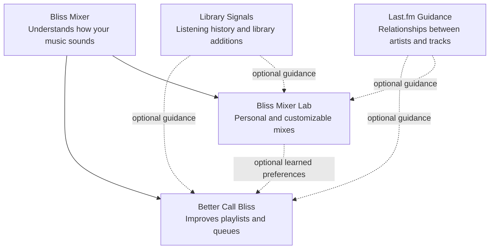
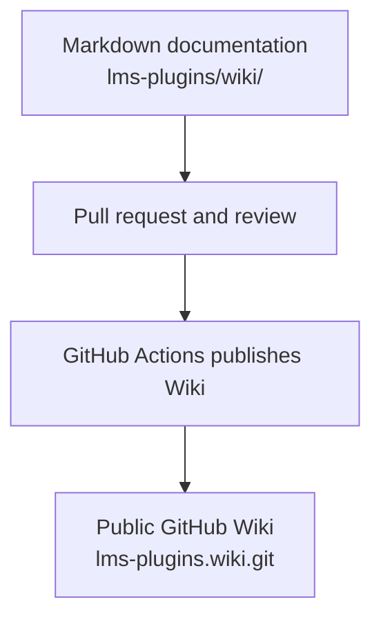

# Concept for the LMS Plugins Wiki

**Status:** Proposal for review — 26 November 2026

## 1. Purpose and review of existing documentation

Position the Wiki as a **practical, scenario-driven user guide for Lyrion Music Server users**, rather than an extension of the technical documentation in the individual repositories.

The central question:

> What can these plugins do to improve my everyday music-listening experience, and how can I use them to achieve that?

Users should discover capabilities without already knowing which plugin provides them, how Bliss works internally, or what a guidance provider is.

### Existing documentation

| Repository | Existing documentation |
| --- | --- |
| [LMS Plugins](https://github.com/chrober/lms-plugins) | Collection overview, plugin selection, dependencies and installation |
| [Better Call Bliss](https://github.com/chrober/lms-better-call-bliss) | Playlist optimization, bridging, extension, queue manipulation and musical journeys |
| [Bliss Mixer Lab](https://github.com/chrober/lms-blissmixer-lab) | Personalized mixing, DSTM, artist repeat policies, virtual libraries and alternative mixing actions |
| [Library Signals](https://github.com/chrober/lms-guidance-library-signals) | Rediscovery, listening history, play counts and recent library additions |
| [Last.fm Guidance](https://github.com/chrober/lms-guidance-lastfm) | Related tracks and artists, additional mixing guidance and offline listening |

The READMEs, particularly their “What can I do with it?” sections, provide a strong foundation. However, they are naturally organized around individual plugins. A user interested in rediscovering music in a large collection must already understand the relationship between Bliss Mixer Lab and Library Signals to locate the relevant information.

| Existing READMEs | Proposed Wiki |
| --- | --- |
| Plugin-oriented | Listening-scenario-oriented |
| What does this plugin do? | What do I want to achieve? |
| Individual features | Practical outcomes |
| Individual plugin configuration | Combined plugin usage |
| Technical requirements | Guided setup |
| Architecture and implementation | Illustrative everyday examples |

Retain the READMEs largely as they are; the Wiki is a complementary, cross-plugin documentation layer.

## 2. Proposed information architecture

Use a hybrid architecture with **usage scenarios as primary navigation** and individual plugin descriptions as secondary reference material. Readers should not need to understand the ecosystem before discovering its benefits.

- **Home** — welcome and discover what is possible.
- **Getting started**
  - Understanding Bliss and its extensions
  - Which plugins do I need?
  - Installation and first steps
- **Make more of your playlists**
  - Make your playlists flow better
  - Smooth transitions without changing the order
  - Turn a short playlist into a long listening session
  - Improve your current player queue
  - Take a musical journey to a song or album
- **Keep the music playing**
  - A different Don't Stop the Music experience
  - Teach Bliss your musical preferences
  - Avoid repetitive mixes
  - Mix within a selected music collection
- **Rediscover your music collection**
  - Rediscover forgotten favorites
  - Give rarely played music a chance
  - Discover your recently added albums
  - Rediscover related artists and songs
- **Combine plugins for a better experience**
  - Personalized playlists and mixes
  - Combining listening history and Last.fm
  - Music discovery without internet access
- **Plugin reference**
  - Better Call Bliss
  - Bliss Mixer Lab
  - Bliss Guidance: Library Signals
  - Bliss Guidance: Last.fm
- **Help and frequently asked questions**
  - Common questions and troubleshooting

This is the logical structure, not necessarily a one-page-per-entry plan. Closely related scenarios can initially share a page to keep the Wiki manageable.

## 3. Wiki home page

The home page could also serve as a landing page for visitors from the Lyrion community forum. Introduce four reasons to explore the collection rather than immediately introducing four plugins.

### Proposed home-page copy

> # Get more out of your music collection
>
> Music is more than a collection of albums and tracks. These extensions for Lyrion Music Server help you create better playlists, enjoy more personal mixes and rediscover music you already own.
>
> **Make your playlists flow**
>
> Turn a collection of favorite songs into a coherent listening experience, with smoother transitions and suitable additions.
>
> **Keep the music playing**
>
> Enjoy continuous mixes that reflect your musical preferences, without having to decide what to play next.
>
> **Rediscover the music you own**
>
> Hear forgotten favorites, overlooked albums and recent additions instead of always returning to the same songs.
>
> **Explore musical connections**
>
> Discover relationships between tracks and artists beyond their acoustic similarities.
>
> **New here?** Start with *Which plugins do I need?*

For the actual Wiki, use genuine plugin screenshots and purpose-built illustrations rather than generic stock photography.

## 4. Explain the Bliss ecosystem in simple language

Dedicate a page to why the plugins are separate and how they interact with CDrummond's original [Bliss Mixer](https://github.com/CDrummond/lms-blissmixer).



The guidance connections apply to supported workflows, notably Bliss (Lab) DSTM and Better Call Bliss optimization.

Suggested explanation:

> Bliss Mixer understands how your music sounds.
>
> Better Call Bliss uses this knowledge to improve your playlists and player queues.
>
> Bliss Mixer Lab uses it to explore new ways of creating mixes, including mixes that reflect your personal taste.
>
> Library Signals adds knowledge about your listening habits, while Last.fm Guidance adds knowledge about musical relationships.
>
> You can choose the extensions that suit your listening habits. You don't need to install all of them.

Explain the **Bliss-first principle** in everyday language: additional information helps choose between musically suitable songs rather than replacing acoustic similarity. No discussion of Rust engines, native binaries, databases, scoring algorithms or provider interfaces is needed here.

## 5. Usage scenario catalogue

Some scenarios below are explicitly described in the READMEs; others are practical applications of documented features. The original Bliss Mixer and its completed library analysis are assumed throughout.

### Playlists and listening sessions

| Scenario | Benefit | Plugin |
| --- | --- | --- |
| My favorite songs don't flow well together | Reorder tracks for smoother transitions | Better Call Bliss |
| I don't want to change my carefully curated playlist | Add suitable bridging tracks | Better Call Bliss |
| I'm hosting a dinner party | Extend a short playlist to last the entire evening | Better Call Bliss |
| I'm not happy with what's coming up next | Improve upcoming tracks without interrupting the current song | Better Call Bliss |
| I want to hear a particular album next | Create a musical journey to the album | Better Call Bliss |
| I want to take a musical detour | Visit another song or album and return to the original queue | Better Call Bliss |

### Continuous and personalized listening

| Scenario | Benefit | Plugin |
| --- | --- | --- |
| I don't want to constantly choose what plays next | Automatic continuation with Bliss (Lab) | Bliss Mixer Lab |
| Bliss doesn't always understand what I consider similar | Learn personal musical preferences | Bliss Mixer Lab |
| The same artists appear too frequently | More precise artist repeat handling | Bliss Mixer Lab |
| I want a dedicated Christmas music experience | Respect the player's virtual library and optionally suspend Christmas exclusions for that library | Bliss Mixer Lab |
| I have separate collections for different moods | Restrict DSTM mixes to the selected player library | Bliss Mixer Lab |

### Music rediscovery

| Scenario | Benefit | Plugin combination |
| --- | --- | --- |
| I haven't heard some of my favorite songs in years | Prefer long-unheard tracks | Lab + Library Signals |
| My mixes always contain the same familiar songs | Give less-played tracks more opportunities | Lab + Library Signals |
| I recently added several new albums | Give recent additions more attention | Lab + Library Signals |
| I want a mix of my familiar favorites | Favor frequently played tracks | Lab + Library Signals |
| I want an existing playlist to help me rediscover music | Guide playlist additions using listening history | Better Call Bliss + Library Signals |

### Musical relationships and combined experiences

| Scenario | Benefit | Plugin combination |
| --- | --- | --- |
| Acoustic similarity alone isn't enough for me | Include Last.fm musical relationships | Either host + Last.fm |
| I want to rediscover related artists I already own | Favor musically suitable, related artists | Lab + Last.fm |
| I want playlists that reflect my personal taste | Use learned preferences in playlist optimization | Better Call Bliss + Lab |
| I want related but overlooked music | Combine Last.fm relationships and listening history | Either host + both providers |
| I take my music server on holiday | Prepare artist relationships for offline-friendly listening | Either host + Last.fm |

The combined scenarios are particularly valuable because they communicate the benefits of the ecosystem as a whole.

## 6. Consistent structure for each scenario

Each scenario should have a recognizable editorial structure:

1. **The situation:** A relatable everyday listening experience.
2. **What you can achieve:** The outcome, without technical jargon.
3. **What you need:** Required plugins and optional enhancements.
4. **How to do it:** A short step-by-step guide using actual UI terminology.
5. **What to expect:** The practical result and relevant limitations.
6. **Try this as well:** Related scenarios or useful plugin combinations.

### Example A — Make your playlists flow better

> “I love every song in my playlist, but somehow they don't work particularly well together in their current order.”

Imagine you've created a playlist of 30 favorite songs. Some are quiet and atmospheric, others are energetic and loud. You enjoy all of them, but listening to the playlist sometimes feels like jumping randomly between different moods.

Better Call Bliss can help you find a more natural sequence without removing the songs you selected.

**Illustrative before/after:** the same eight songs in a different order.

| | Track order |
| --- | --- |
| Before | A → B → C → D → E → F → G → H |
| After | E → A → C → H → G → D → B → F |

A possible visual is a before/after bar diagram representing a single musical characteristic, with abrupt changes in the original order and smoother changes in the optimized order. This is a simplified illustration, not an actual optimization result or a claim that Bliss sorts by energy: actual optimization considers multiple acoustic characteristics and configured constraints.

**What you need:** Bliss Mixer and Better Call Bliss. No additional guidance plugins are necessary.

**How to do it**

1. Open **Extras → Better Call Bliss**.
2. Select one of your saved playlists.
3. Choose to optimize the track order without adding tracks.
4. Run a preview and review the suggested sequence.
5. Save the result as a new playlist.

**What happens to my original playlist?** Nothing changes unless you explicitly choose to overwrite it. Save the optimized version separately and compare the two.

**Try this as well:** Smooth transitions without changing the original order, or extend your playlist with additional tracks.

### Example B — Take a musical journey

> “I'm listening to something right now, but I'd love to hear another album without abruptly changing the mood.”

Give the three distinctive **Bliss me there...** actions a dedicated page with visual examples.

```text
Current queue:
[Now] [B] [C] [D] [E]

Bliss me there...
[Now] [+] [+] [Target]

Bliss me there... and back again!
[Now] [+] [Target] [+] [B] [C] [D] [E]

Bliss me there... when we're through!
[Now] [B] [C] [D] [E] [+] [+] [Target]
```

Legend: Now = currently playing; B–E = original upcoming queue; + = illustrative bridging track; Target = selected song or album.

- **Bliss me there...** — Take a route directly to the destination.
- **Bliss me there... and back again!** — Take a detour and return to the original upcoming queue.
- **Bliss me there... when we're through!** — Finish the current queue before heading to the destination.

These shortcuts require Material Skin. Unlike the playlist editor, successful routes are applied automatically after validating the live player queue. If a route fails or the queue changes incompatibly, no changes are made. An album destination includes its local tracks in disc and track order. Diagrams are illustrative.

### Example C — Rediscover the music you already own

> “I have thousands of albums, but sometimes I feel like I'm listening to only a small part of my collection.”

Library Signals can help Bliss give more attention to music you rarely play, haven't heard for a long time or have recently added.

| Approach | Benefit |
| --- | --- |
| Forgotten favorites | Prefer songs you haven't listened to for months or years. |
| Hidden gems | Give songs with low play counts more opportunities to appear. |
| New discoveries | Hear more of the albums you recently added. |

**What you need:** Bliss Mixer, Bliss Mixer Lab and Library Signals.

Enable Library Signals in Bliss Mixer Lab, configure your preferred listening-history signals and select **Bliss (Lab)** as your Don't Stop the Music provider.

Your mixes will continue to be based on acoustic similarity. Library Signals simply helps decide which suitable tracks deserve more attention.

You can also use Library Signals with Better Call Bliss to guide music added to playlists.

## 7. Plugin selection guide

A page titled **Which plugins do I need?** should make dependencies immediately understandable. The interactive prototype in the original discussion is represented here by a static decision table, suitable for GitHub Wiki Markdown.

| What would you like to achieve? | Install in addition to Bliss Mixer |
| --- | --- |
| Improve or extend my playlists and queues | Better Call Bliss |
| Enjoy continuous, automatic mixes | Bliss Mixer Lab |
| Personalize music selection based on my taste | Bliss Mixer Lab; optionally Better Call Bliss for playlists |
| Rediscover music using my listening history | Either host + Library Signals |
| Use Last.fm musical relationships | Either host + Last.fm Guidance |
| Use stored Last.fm artist relationships offline | Either host + Last.fm Guidance (API Key source, offline preferred) |

Combine rows for multiple goals. The original Bliss Mixer is the required foundation for the two hosts; complete its library analysis first. Better Call Bliss and Lab are independent and neither requires the other for basic operation. Providers are optional and must be enabled on the relevant host settings page. For guidance-only goals, suggest Lab for continuous listening and Better Call Bliss for playlist work.

Offline preferred can use stored artist relationships; it is not strict offline-only, and track relationships are not all permanently stored. Last.fm is not a streaming source in this context.

## 8. Visual documentation strategy

Use visuals that explain a feature rather than decorate a page.

| Visual element | Purpose | Priority |
| --- | --- | --- |
| Playlist before/after diagrams | Explain reordering | High |
| Bridging track diagrams | Explain preserving the original order | High |
| Musical route diagrams | Explain the three destination actions | High |
| Plugin relationship diagram | Explain the ecosystem | High |
| Actual Better Call Bliss screenshots | Show how to use the editor | High |
| Actual DSTM selection screenshots | Show where to select Bliss (Lab) | High |
| Guidance settings screenshots | Show how to enable and configure providers | High |
| Preference survey screenshots | Explain personalization | Medium |
| Last.fm offline preparation screenshots | Explain preparation for offline listening | Medium |

Use Material Skin for most screenshots while explicitly indicating which features require it. Better Call Bliss's editor does not require Material Skin; its destination shortcuts do.

Establish a consistent visual language: original tracks gray, currently playing tracks green, added tracks blue and destination tracks orange. Add text labels so that color is not the only means of conveying meaning.

## 9. Scope of the initial Wiki

Start with approximately **12 content pages**, plus a sidebar and footer.

| Proposed Wiki page | Content |
| --- | --- |
| Home | Introduction and scenario navigation |
| Understanding Bliss | Ecosystem and plugin relationships |
| Getting Started | Plugin selection, requirements and installation |
| Make Your Playlists Flow | Reordering and bridging |
| Extend Your Playlists | Longer listening sessions |
| Improve Your Player Queue | Working with live queues |
| Take a Musical Journey | All three destination shortcuts |
| Keep the Music Playing | DSTM, artist repeat behavior and virtual libraries |
| Personalize Your Mixes | Preference learning and its use in both hosts |
| Rediscover Your Music | All Library Signals scenarios |
| Explore Musical Connections | Last.fm guidance, combined guidance and offline listening |
| Plugins and FAQ | Plugin references, limitations and troubleshooting |

Use GitHub's custom `_Sidebar.md` and `_Footer.md` for consistent navigation. Split topics into dedicated pages later as content grows, without changing the overall architecture.

## 10. Editorial principles

| Prefer | Avoid where possible |
| --- | --- |
| Songs that sound good together | Acoustically eligible candidate pool |
| Your personal musical preferences | Learned similarity matrix |
| Additional musical knowledge | External scoring signals |
| Songs you haven't heard in a long time | Last-played timestamp weighting |
| Suitable songs between two tracks | Intermediate route candidates |
| Preview your improved playlist | Optimizer job output |
| Stored artist relationships | Persistent SQLite artist graph |

Use technical terms when they correspond to actual UI labels or are needed to configure a feature.

Consistently communicate that:

- The original Bliss Mixer remains available and functional.
- The four extensions are not an all-or-nothing bundle.
- Guidance providers must be explicitly enabled.
- Additional guidance expresses preferences, not guaranteed track selections.
- Audio files are not modified.
- Bliss Mixer Lab is experimental by design.

Preserve the established compatibility wording: developed and tested with Lyrion 9.1; older versions may work but have not been tested. Link to the plugin READMEs for exact requirements and technical details rather than duplicating them.

## 11. Proposed Wiki implementation and publication

The repository has Wiki enabled and the GitHub connection has normal repository write permissions. Direct Wiki-specific operations are not available through the current connector; the existing Wiki's page inventory could not be verified through it.

GitHub stores Wikis in separate Git repositories. The Wiki remote is:

```text
https://github.com/chrober/lms-plugins.wiki.git
```

Consider maintaining the canonical Wiki source in the main `lms-plugins` repository:

```text
lms-plugins/
├── .github/
│   └── workflows/
│       └── publish-wiki.yml
├── wiki/
│   ├── Home.md
│   ├── _Sidebar.md
│   ├── _Footer.md
│   ├── Getting-Started.md
│   ├── Understanding-Bliss.md
│   ├── Make-Your-Playlists-Flow.md
│   ├── ...
│   └── images/
├── README.md
└── repo.xml
```



Advantages:

- Create and edit source pages through the existing GitHub connection.
- Review documentation changes through normal pull requests.
- Validate internal links and referenced images in CI.
- Publish changes automatically after merging.
- Keep the Wiki source accessible in the normal repository.

**Open implementation questions:** verify authentication and push permissions against the separate Wiki repository before relying on automatic publication. If the Wiki is not initialized, its first page must be created. Check for existing pages before any synchronization; avoid inadvertently overwriting them. The publication workflow is a proposal, not an implemented or tested capability.

GitHub documentation: [About wikis](https://docs.github.com/en/communities/documenting-your-project-with-wikis/about-wikis), [Adding or editing wiki pages](https://docs.github.com/en/communities/documenting-your-project-with-wikis/adding-or-editing-wiki-pages).

## 12. Recommended direction and rollout

Treat the Wiki less as a conventional software manual and more as a **guide to getting more enjoyment out of a personal music collection**.

The four editorial themes:

- **Musical flow** — make existing playlists and listening sessions more coherent.
- **Personalization** — make music selection reflect individual musical taste.
- **Rediscovery** — get more value out of a collection that may have been accumulated over decades.
- **Musical exploration** — discover interesting connections and journeys within that collection.

These themes can remain the editorial identity of the Wiki regardless of how many plugins are added to the collection in future.

Start by implementing the home page, ecosystem explanation, getting-started guide, custom sidebar and two representative scenario pages: **Make Your Playlists Flow** and **Rediscover Your Music**. Establish the tone, level of detail, visual language and navigation before populating the remaining pages.

This is a concept for review, not the published Wiki. The chat's interactive selector and visual mockups have been translated into Markdown-compatible tables, diagrams and descriptions; final screenshots and illustrations remain to be prepared.
