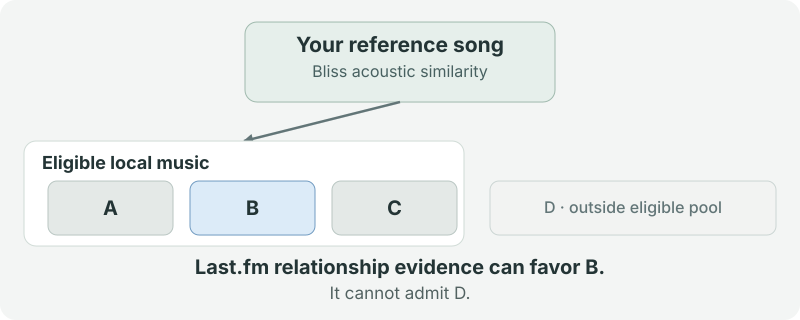
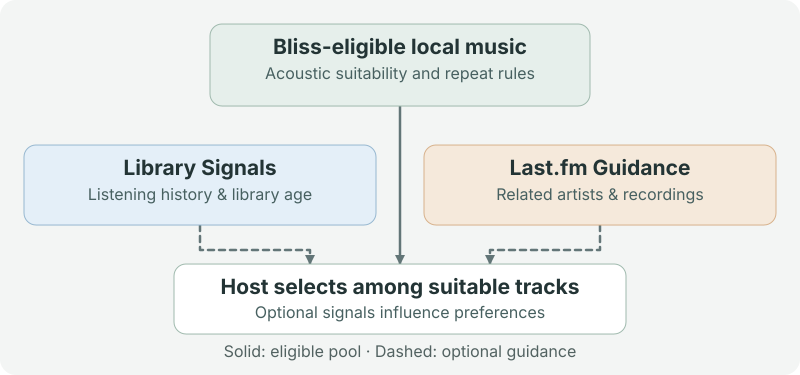

# Explore musical connections

> "I love the sound of this artist. I wonder which related artists I already have in my music collection."

Sound is one way of finding connections between songs. Last.fm provides another: relationships between artists and between individual recordings. Last.fm Guidance lets Better Call Bliss and Bliss Mixer Lab use that knowledge alongside acoustic similarity.

<figure class="guide-figure" markdown="1">

<figcaption>Illustrative relationships only. Additional knowledge never makes an ineligible track eligible.</figcaption>
</figure>

## Add Last.fm knowledge to your mixes

**What you need:** Bliss Mixer with completed analysis, either Bliss Mixer Lab for automatic DSTM or Better Call Bliss for playlist and queue workflows, and [Bliss Guidance: Last.fm](https://github.com/chrober/lms-guidance-lastfm).

### Choose your source

| Source | When to use it |
| --- | --- |
| **LastMix** | You already have Michael Herger's [LastMix](https://github.com/michaelherger/LastMix) plugin installed and enabled and want to reuse its Last.fm relationships. |
| **API Key** | You want to query Last.fm directly with a valid key, or prepare a local store of artist relationships for offline-friendly listening. |

LastMix can also create mixes on its own. Last.fm Guidance is different: it contributes information to the compatible Bliss plugins and never plays music independently.

With API Key mode, you can enter your own key or reuse a saved custom LastMix API key. Reusing the key does not require enabling LastMix. See the [provider documentation](https://github.com/chrober/lms-guidance-lastfm#choose-your-lastfm-source) for details.

### Try it

1. Install Last.fm Guidance through the [plugin feed](getting-started.md#install-the-collection).
2. In its settings, choose and configure **LastMix** or **API Key**.
3. In **Bliss Mixer Lab** or **Better Call Bliss** settings, explicitly enable Last.fm Guidance and review any supported overrides.
4. Start a Bliss (Lab) DSTM session, or preview a Better Call Bliss playlist optimization with additions.
5. Compare the results with the provider disabled.

Artist and track relationships offer two complementary ways to discover connections. Last.fm Guidance works with the music you already own, following the [sound-first principle](understanding-bliss.md#sound-first-additional-knowledge-second).

## Related music you haven't heard in a while

<figure class="guide-figure" markdown="1">

<figcaption>Combine preferences within the same eligible local pool. Neither provider operates as an independent mixer.</figcaption>
</figure>

Enable both Last.fm Guidance and [Library Signals](rediscover-your-music.md) in a supported mixing or playlist plugin. For example, start with a favorite Miles Davis recording. Last.fm might help identify related artists already in your collection, while Library Signals can give a rarely played John Coltrane recording more weight if it is also a suitable musical match. This is an illustrative listening idea, not a predicted recommendation.

You can also favor related artists whose music you haven't heard in a while using Library Signals' artist last-played preference. Keep the influences moderate at first. These preferences can reinforce each other or point toward different candidates. The host still makes the final selection using its supported rules and acoustic checks.

## Bring some artist knowledge with you

With the **API Key** source, you can use **Update offline Last.fm library** while connected and retain artist relationships locally. **Offline preferred** can reuse available stored artist data. Track similarities use a separate short-lived cache; they are not part of the durable artist store.

Offline preferred is not a strict offline-only setting. Initial acquisition and later missing-data lookups may use the internet when connectivity is available. If Last.fm is unavailable, the host can continue with partial or neutral guidance. See [prepare your music for travel](your-music-anywhere.md#optional-lastfm-knowledge-without-continuous-connectivity) for practical steps and limitations.

The original [Last.fm Guidance documentation](https://github.com/chrober/lms-guidance-lastfm) covers the source options, provider settings, storage limits and maintenance.
