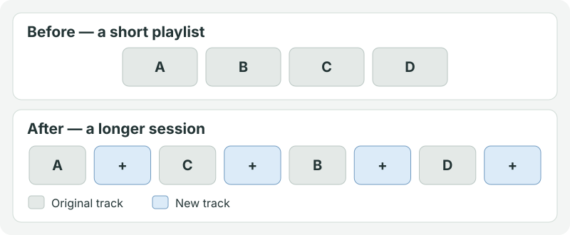

# Extend your playlists

> "I've made a great half-hour playlist for dinner. But my friends are staying for the whole evening."

You don't have to find another two hours of music by hand. Use the songs you have already chosen as a starting point for a much longer listening session. Better Call Bliss looks for suitable songs in your local library while keeping the original tracks.

<figure class="guide-figure" markdown="1">

<figcaption>Gray represents your original choices; blue represents additional tracks. The example is illustrative, not a measured optimization result.</figcaption>
</figure>

## Choose how much music you want

| When you want… | Choose under Chosen amount |
| --- | --- |
| Ten more songs for the drive home | **Add exactly N tracks** |
| A small selection to become a 40-track mix | **Reach a final track count** |
| Twice as many songs as before | **Double the track count** |
| Music for a two-hour dinner | **Reach a target duration** |

Unlike inserting a fixed number of bridges between each pair of songs, extension is about the playlist as a whole. Better Call Bliss looks at all your original songs as a fixed reference for the additions. The newly added songs don't progressively redefine that reference.

## Try it for a dinner party

**What you need:** Bliss Mixer with completed analysis and Better Call Bliss. See [installation](getting-started.md#install-the-collection).

1. Open **Extras → Better Call Bliss** and select a saved playlist.
2. Under **Source-track order**, choose **Optimize source order** if you are happy for your songs to move, or **Preserve source order and fill gaps** if their sequence matters.
3. Under **Additional tracks**, choose **Extend playlist**.
4. Choose **Reach a target duration** and enter 120 minutes. Set the shorter and longer tolerances to suit your plans. With the default 10% on each side, the acceptable duration is 1 hour 48 minutes to 2 hours 12 minutes.
5. Run **Preview**, review the actual duration, new tracks and order, then save a new playlist or send the result to your player.

The original playlist is not changed by generating a preview. The final length includes the songs you started with; it is not two additional hours.

!!! note "A duration target is a range, not a promise"
    Duration targeting requires a compatible optimizer and valid track durations. If the source already fits within the requested range, no tracks are added. If it is too long or no valid result can be found within the search and constraints, the job fails rather than silently accepting a partial extension. Try wider tolerances or less restrictive repeat rules if appropriate.

## Keep the mood right

Choose a **Candidate library** such as Dinner & Lounge, Summer or Sunday Jazz if you want new songs to come from a particular part of your collection. Original songs remain valid even if they are outside that virtual library. [Learn how to switch a player's musical world](music-for-every-season.md).

If the music is already playing, you can [work with the current queue](improve-your-player-queue.md) instead of creating a saved playlist. To make additions more personal, try [Library Signals](rediscover-your-music.md) or [Last.fm Guidance](explore-musical-connections.md).

For exact options and constraints, consult [the extension documentation](https://github.com/chrober/lms-better-call-bliss/blob/main/ALGORITHMS.md#extend-playlist).
