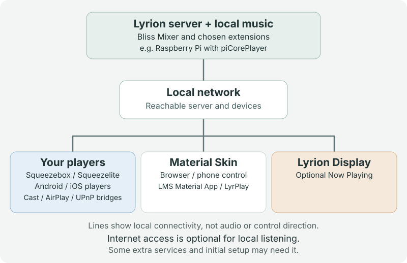

# Build your Lyrion setup

You don't need a complicated system or every available plugin. Start with a working Lyrion server, a local music collection and Bliss Mixer. Add the extensions that match your listening habits.

<figure class="guide-figure" markdown="1">

<figcaption>Your server selects music; native Lyrion players or compatible devices connected through optional bridges play it. Phones and tablets control the server, and a separate display can show what's playing.</figcaption>
</figure>

## Choose your plugins

| I want to… | Add to Bliss Mixer |
| --- | --- |
| Improve the flow of playlists and queues | Better Call Bliss |
| Enjoy continuous mixes | Bliss Mixer Lab |
| Teach Bliss my musical preferences | Bliss Mixer Lab; optionally Better Call Bliss for supported playlist workflows |
| Rediscover overlooked tracks | Library Signals + **Bliss Mixer Lab** (automatic mixes) or **Better Call Bliss** (playlists and queues) |
| Consider musical relationships from Last.fm | Last.fm Guidance + **Bliss Mixer Lab** (automatic mixes) or **Better Call Bliss** (playlists and queues) |
| Switch a player to a seasonal or mood-specific library | Bliss Mixer Lab + Material Skin; Virtual Library Creator recommended |

For the two guidance options, install the guidance plugin **and at least one of the two named mixing or playlist plugins**. You can use both if you want guidance in both workflows. Enable the provider separately in each plugin's settings. See [Understanding Bliss](understanding-bliss.md) for the roles of the four plugins.

## Required foundation

- [Bliss Mixer](https://github.com/CDrummond/lms-blissmixer) by Craig Drummond. Install and enable it, then complete its analysis of your local music library. Better Call Bliss and Bliss Mixer Lab use that analysis and the existing Bliss installation.
- A working [Lyrion Music Server](https://lyrion.org/) and compatible local library. The collection was developed and tested with **Lyrion 9.1**; older versions may work but have not been tested. Official plugin-feed packages include platform-specific binaries where needed; consult the individual plugin's requirements.

## Your server

Already running Lyrion on a computer or dedicated music server? You can keep using it. If you want a small, dedicated Raspberry Pi music system, [piCorePlayer](https://www.picoreplayer.org/) is an excellent option.

piCorePlayer can run Lyrion Music Server, act as a Squeezelite music player, or combine both roles on the same Raspberry Pi. You can connect local storage or access your music on a NAS. See the [piCorePlayer server installation guide](https://docs.picoreplayer.org/how-to/install_lms/) to get started. It is an optional server platform, not a requirement for these plugins.

## Your players

You don't need to replace all your audio equipment to enjoy Lyrion. Use an original Squeezebox, a Squeezelite-based player (including piCorePlayer), or bring compatible network audio devices into your Lyrion system with these optional server-side bridge plugins by Philippe (philippe44).

| Project | What you can use |
| --- | --- |
| [Chromecast Bridge (LMS-Cast)](https://github.com/philippe44/LMS-Cast) | Compatible Chromecast / Google Cast audio playback devices. |
| [AirPlay Bridge (LMS-Raop)](https://github.com/philippe44/LMS-Raop) | Compatible AirPlay speakers, receivers and other audio devices. |
| [UPnP/DLNA Bridge (LMS-uPnP)](https://github.com/philippe44/LMS-uPnP) | Compatible UPnP/DLNA network audio renderers, including some hi-fi streamers and receivers. |

Install the appropriate bridge through Lyrion's third-party plugin manager and follow its setup instructions. Supported devices can then appear as players in Lyrion, so you can select music for them using your usual controllers and use the music-selection features described in this guide.

The bridges are not required for native Lyrion players. Device discovery, supported formats, gapless playback, synchronization and offline behavior can vary with the bridge, receiver and configuration; check the linked projects for details. These are playback integrations, not guidance providers or controller apps.

## Recommended interface

[Material Skin](https://github.com/CDrummond/lms-material), also by Craig Drummond, is a modern way to browse music, manage queues and control players. It is not required for the basic Better Call Bliss editor or Lab mixing, but is required for the three **Bliss me there...** shortcuts and Lab's optional Material/player-library synchronization.

## Optional plugins

| Project | Why it is useful |
| --- | --- |
| [Virtual Library Creator](https://github.com/AF-1/lms-virtuallibrarycreator) by AF-1 | Create and manage themed collections, such as Christmas, Summer or Sunday Jazz, in a browser. Particularly useful when you want to switch a player to a different listening mood. |
| [Alternative Play Count](https://github.com/AF-1/lms-alternativeplaycount) by AF-1 | Alternative source of play counts and last-played information for Library Signals. Native Lyrion listening history is sufficient without it. |
| [LastMix](https://github.com/michaelherger/LastMix) by Michael Herger | Creates Last.fm-based mixes independently and can supply Last.fm relationships to Last.fm Guidance. The guidance plugin also supports direct API Key access; stored offline artist information requires that source. |

## Recommended controllers and optional display

| Project | Role |
| --- | --- |
| [LMS Material App](https://github.com/CDrummond/lms-material-app) by Craig Drummond | Android controller using Material Skin: browse, select and manage your music and control existing players. |
| [LyrPlay](https://github.com/mtxmiller/LyrPlay) by Eric Miller | Apple alternative for iPhone/iPad with an integrated Material Skin control interface. Its built-in audio player is an additional capability, not the primary reason for this recommendation. |
| [Lyrion Display](https://github.com/chrober/lyrion-display) | Optional fullscreen read-only Now Playing companion for compatible Fire TV, Android TV and tablets. |

These apps require a reachable Lyrion server with Material Skin. You can also use Material Skin directly in a web browser. None of the apps is needed for the core Bliss extensions. Consult the app repositories for device compatibility and installation.

## Install the collection

1. Install and enable Bliss Mixer and complete its library analysis.
2. Open **Lyrion Settings → Plugins** and add the following URL as an additional plugin repository:

    ```text
    https://raw.githubusercontent.com/chrober/lms-plugins/main/repo.xml
    ```

3. Apply the change, install the plugins you want and restart Lyrion if requested.
4. Follow the individual setup instructions: [Better Call Bliss](https://github.com/chrober/lms-better-call-bliss#installation), [Bliss Mixer Lab](https://github.com/chrober/lms-blissmixer-lab#installation), [Library Signals](https://github.com/chrober/lms-guidance-library-signals#installation), or [Last.fm Guidance](https://github.com/chrober/lms-guidance-lastfm#installation).
5. If you install a guidance plugin, configure its defaults and **enable it on the settings page of the host** where you want it to work. Installing a provider alone does not affect a mix.

!!! tip "Try one change at a time"
    Start with a standard Bliss mix or a playlist preview. Then add one extension or guidance preference and compare. It is easier to understand the effect of an individual setting.

## Listen locally

The extensions have been tested by the author on a Raspberry Pi 4 setup. piCorePlayer is one way to build such a compact Lyrion server. A compact server with locally accessible music and completed Bliss analysis is a useful starting point for travel or privacy-conscious home listening; performance depends on your library and hardware.

Local music selection and Library Signals can work without an internet connection. If you want Last.fm guidance while travelling, the API Key source lets you prepare an artist relationship library while online. Previously stored artist information can help later; track relationships use a separate short-lived cache. Offline preferred is not strict offline-only. For a firm no-internet setup, isolate the server at the network level, keep music and required assets local, and retain network connectivity between your server and controllers. Other services, metadata providers or devices may still have online features.

## Try your first scenario

[Make your playlists flow](make-your-playlists-flow.md) or [Rediscover your music](rediscover-your-music.md).
