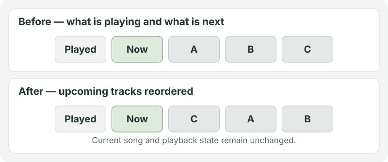

# Improve your player queue

> "This song is perfect. The rest of the queue, not so much."

Sometimes you don't want to create a new playlist or interrupt the music. You simply want a better sequence of what is coming up. Better Call Bliss can work from a snapshot of your player queue, let you review the proposed result, and update the upcoming part while preserving the current track.

<figure class="guide-figure" markdown="1">

<figcaption>The green track keeps playing; gray past entries stay untouched. Only the upcoming segment is replaced in this example.</figcaption>
</figure>

## Improve what's coming next

**What you need:** Bliss Mixer with completed analysis, Better Call Bliss and a player with a suitable queue containing at least two local tracks in the selected source scope.

1. In **Extras → Better Call Bliss**, select a player queue as the source.
2. Select the upcoming tracks as the source scope. The editor captures a snapshot when the job starts.
3. Choose the order and addition options — for example, optimize the order with no additions.
4. Generate a **Preview** and review the result.
5. Choose the same player as the output and **Replace upcoming tracks**. Apply the result.

The current track and playback state are preserved. If the player has advanced while you were reviewing, the plugin rechecks the queue against the source snapshot and may trim already-played preview items when it can safely recognize the queue. An incompatible change requires a fresh preview rather than applying a stale result.

## Choose where the result goes

| Queue action | Effect |
| --- | --- |
| **Replace upcoming tracks** | Keep the current track and replace the later entries. |
| **Replace queue** | Replace the entire queue; playback starts only if the corresponding option is checked. |
| **Append to queue** | Add the result to the end of the queue. |
| **Play next** | Insert the result after the current track. |

The editor also supports full-queue and current-plus-upcoming source scopes. Source scope and output action are different decisions: first select what to work with, then choose where the result belongs.

!!! tip "Keep a favorite song playing"
    If preserving the currently playing track matters, use **Replace upcoming tracks**, not **Replace queue**. Always review the preview before applying.

## Want to hear a specific album next?

The [Bliss me there... shortcuts](take-a-musical-journey.md) are an alternative to the editor. They build a musical route to a selected destination and apply a successfully validated result automatically. They do not ask for preview acceptance.

See [Better Call Bliss](https://github.com/chrober/lms-better-call-bliss) for the available source scopes and output options.
