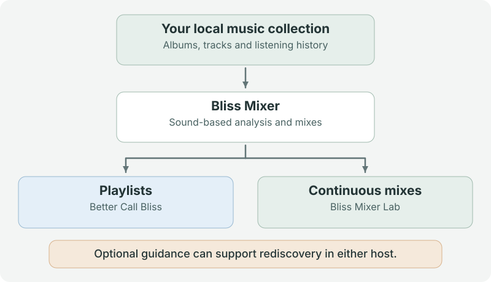

A listener's guide to Bliss extensions for Lyrion

Your music collection is full of possibilities. Make familiar playlists sound more natural, discover songs you have overlooked, or let the music keep playing in a way that feels right for you.

These independent plugins build on [Lyrion Music Server](https://lyrion.org/) and [Bliss Mixer](https://github.com/CDrummond/lms-blissmixer) by Craig Drummond. Choose the ones that fit the way you listen; you don't need to install them all.

<figure class="guide-figure" markdown="1">

<figcaption>Your own music, with more ways to enjoy it.</figcaption>
</figure>

## What would you like to do?

### Make your playlists flow

Love the songs but not the transitions? Rearrange a playlist, or keep its original order and add suitable songs in between.

[Make your playlists flow →](make-your-playlists-flow.md) · [Extend a playlist](extend-your-playlists.md)

### Keep the music playing

Let Don't Stop the Music continue your listening session. Explore personal preferences or choose a virtual library for a particular mood.

[Keep the music playing →](keep-the-music-playing.md) · [Personalize your mixes](personalize-your-mixes.md)

### Rediscover the music you own

Give forgotten favorites, rarely played tracks and newly added albums more opportunities to appear.

[Rediscover your music →](rediscover-your-music.md)

### Explore musical connections

Take a musical journey to a song or album, or let Last.fm relationships add another perspective to sound-based selection.

[Explore musical connections →](explore-musical-connections.md) · [Take a musical journey](take-a-musical-journey.md)

### Your music, anywhere, under your control

Keep your library and acoustic analysis on a small local server. Bring your music on a trip or listen at home without needing an online recommendation service.

[Your music, anywhere →](your-music-anywhere.md)

## Make your music part of the room

Already using Material Skin? [Lyrion Display](https://github.com/chrober/lyrion-display) is an optional fullscreen Now Playing display for compatible Android devices and Fire TV. Use it beside your stereo while controlling playback with your usual Lyrion client.

## New here?

Start with [Understanding Bliss](understanding-bliss.md), or go straight to [Build your Lyrion setup](getting-started.md) if you're ready to install.

This guide accompanies [the plugin collection](https://github.com/chrober/lms-plugins). The original Bliss Mixer, Material Skin and Lyrion itself make these experiences possible; the extensions build on their work.
