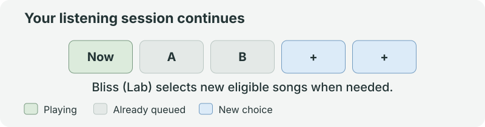

# Keep the music playing

> "I just want to put on a song I like and enjoy the next hour without constantly picking music."

Lyrion's **Don't Stop the Music (DSTM)** can choose more tracks when your current queue needs continuing. Bliss Mixer Lab adds a separate **Bliss (Lab)** option, based on the analysis and settings of the original Bliss Mixer.

<figure class="guide-figure" markdown="1">

<figcaption>The current song stays in place. New tracks are chosen as needed; this is not a fixed playlist generated in advance.</figcaption>
</figure>

## Try a different automatic mix

**What you need:** Bliss Mixer with completed library analysis and Bliss Mixer Lab.

1. Open the **Bliss Mixer Lab** settings page and review **Experimental settings**, particularly **Learned matrix and track selection**.
2. Select **Bliss (Lab)** as the Don't Stop the Music provider for your listening session.
3. Start with a song or a few songs you feel like hearing.
4. Let the music continue. Compare with the original Bliss DSTM provider if you like.

You don't need a learned preference model or any guidance plugins to start. Lab is experimental and installed alongside the original Bliss Mixer, not in place of it.

## Less repetition, more variety

Sometimes collaborations make an artist appear more often than you expect. Lab lets you decide what counts as the same artist for repeat avoidance.

| Artist identity | Example: David Bowie and a Queen & David Bowie collaboration |
| --- | --- |
| **Any shared credited artist** | A shared artist is counted as a repeat. |
| **Primary artist only** | Only the primary artist is compared. A guest credit alone does not count. |
| **Exact Bliss artist credit** | Different full credit strings can count as different artists. |

The identity policy works together with the repeat windows; it does not by itself set how far apart the tracks must be. Library size and the other filters may limit the available choices.

<figure class="guide-figure" markdown="1">

<figcaption>Under Any shared credited artist, a collaboration with A counts as an A repeat. The other policies interpret the credits differently.</figcaption>
</figure>

## Music to suit the moment

Christmas, summer, a quiet Sunday or an evening with friends: [Music for every season, mood and moment](music-for-every-season.md) shows how to choose a themed library for your player.

## Explore more Lab mixes

The Lab also offers **Similar tracks (Lab)** and **Create bliss mix (Lab)** actions where supported. These let you explore similarities directly, rather than waiting for Don't Stop the Music to continue a queue. The optional guidance plugins are supported in the Lab DSTM workflow; don't assume that every Lab action uses them.

## Make the mix your own

Try [personal preference learning](personalize-your-mixes.md), [listening-history guidance](rediscover-your-music.md) or [Last.fm relationships](explore-musical-connections.md).

See [Bliss Mixer Lab](https://github.com/chrober/lms-blissmixer-lab) for detailed settings and limitations.
