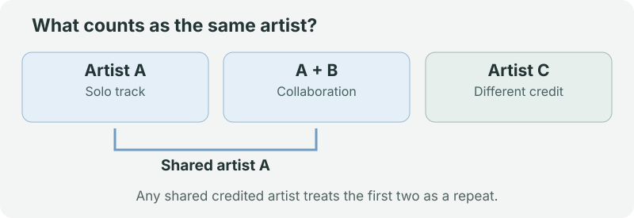
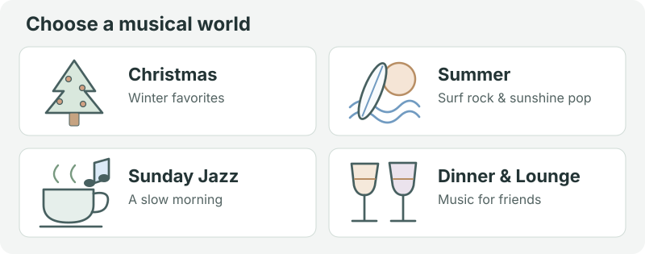
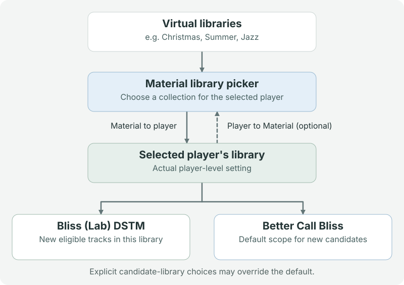
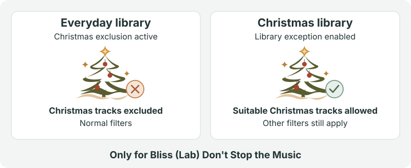

# Keep the music playing

> "I just want to put on a song I like and enjoy the next hour without constantly picking music."

Lyrion's **Don't Stop the Music (DSTM)** can choose more tracks when your current queue needs continuing. Bliss Mixer Lab adds a separate **Bliss (Lab)** option, based on the analysis and settings of the original Bliss Mixer.

<figure class="guide-figure" markdown="1">

<figcaption>The current song stays in place. New tracks are chosen as needed; this is not a fixed playlist generated in advance.</figcaption>
</figure>

## Try a different automatic mix

**What you need:** Bliss Mixer with completed library analysis and Bliss Mixer Lab.

1. Open the **Bliss Mixer Lab** settings page and review the mixing options.
2. Select **Bliss (Lab)** as the Don't Stop the Music provider for your listening session.
3. Start with a song or a few songs you feel like hearing.
4. Let the music continue. Compare with the original Bliss DSTM provider if you like.

You don't need a learned preference model or any guidance plugins to start. Lab is experimental and installed alongside the original Bliss Mixer, not in place of it.

## Less repetition, more variety

Sometimes collaborations make an artist appear more often than you expect. Lab lets you decide what counts as the same artist for repeat avoidance.

| Artist identity | Example: David Bowie and a Queen & David Bowie collaboration |
| --- | --- |
| **Any shared credited artist** | A shared artist is counted as a repeat. |
| **Primary artist only** | Only the primary artist is compared. A guest credit alone does not count. |
| **Exact Bliss artist credit** | Different full credit strings can count as different artists. |

The identity policy works together with the repeat windows; it does not by itself set how far apart the tracks must be. Library size and the other filters may limit the available choices.

<figure class="guide-figure" markdown="1">

<figcaption>Under Any shared credited artist, a collaboration with A counts as an A repeat. The other policies interpret the credits differently.</figcaption>
</figure>

## Music for every season, mood and moment

> "It's snowing outside, the lights are on, and I'm in the mood for Christmas music. I don't want to put together another playlist."

Imagine switching the entire musical character of a player simply by choosing a library in Material Skin.

<figure class="guide-figure" markdown="1">

<figcaption>Create your own collections around the music you enjoy. These are examples of virtual libraries, not automatic mood or season detection.</figcaption>
</figure>

A virtual library is a named view of part of your existing collection. Your files stay where they are, and a song can appear in more than one view. [Virtual Library Creator](https://github.com/AF-1/lms-virtuallibrarycreator), by AF-1, makes it convenient to create and maintain these views in a browser.

| Listening moment | Example library |
| --- | --- |
| The first snow, a cup of tea and Christmas lights | Christmas |
| The sun is out, the windows are open | Summer / Surf Rock |
| Coffee and a slow Sunday morning | Sunday Jazz |
| Friends are coming over for dinner | Dinner & Lounge |
| Time for an energetic workout | Workout Rock |

### One selection, the player's musical world

A browse filter in Material Skin need not be the same as the actual library assigned to a player. Lab's optional synchronization connects these two choices.

<figure class="guide-figure" markdown="1">

<figcaption>The change belongs to the selected player, not just the current browser. Reverse synchronization is a separate option; other controllers require their own support.</figcaption>
</figure>

**What you need:** Material Skin, Bliss Mixer Lab and at least one virtual library. Virtual Library Creator is recommended but not necessary if your libraries already exist.

1. Create a library such as **Christmas** in **Extras → Virtual Library Creator**, with appropriate genre, tag or other selection criteria. Enable it and let Lyrion create the view.
2. In Material Skin, disable its own **Adjust player library** option to avoid conflicts.
3. Open Bliss Mixer Lab settings. Under **Material player-library synchronization**, enable **Use Material's library selection as the selected player's library**.
4. Optionally enable **Show the selected player's library in Material** for the reverse direction. Save the settings and reload each Material client.
5. Select the desired player, then choose your virtual library using the Material library picker.
6. Start a suitable song and select **Bliss (Lab)** as the DSTM provider. Subsequent new candidates are restricted to the player's assigned library.

### It's Christmas — let the festive music play

Bliss Mixer has a Christmas exclusion that you may want to keep active for everyday listening, while allowing festive music in a dedicated library.

In Bliss Mixer Lab settings, under **Allow Christmas tracks in selected virtual libraries**, check the Christmas library if the normal exclusion would otherwise block those tracks.

<figure class="guide-figure" markdown="1">

<figcaption>The exception applies only to Bliss (Lab) DSTM and the checked libraries. It does not switch off the exclusion globally or for Better Call Bliss, and other filters remain active.</figcaption>
</figure>

This is a manual, library-specific preference, not a calendar-based switch. Make sure your collection contains enough suitable analyzed tracks.

### Try it with playlists and different rooms

Better Call Bliss also understands virtual libraries for new additions. The editor's initial **Candidate library** follows the active Material library when available, then the active player's assigned library. You can select a different candidate library explicitly. For route actions, the library context restricts newly generated tracks; existing source tracks and explicitly chosen destinations are distinct from these additions.

Choose Summer for one room and Jazz for another independent player. Changing libraries does not automatically clear already queued music or force all controllers to reflect the change. Switch back to the full library when you want unrestricted selection.

!!! note "The library is a boundary, not a guarantee"
    Bliss acoustic suitability, repeat constraints and other configured filters still apply. If the mix runs out of eligible songs, reconsider the size or rules of the virtual library.

Thanks to AF-1 for Virtual Library Creator and Craig Drummond for Bliss Mixer and Material Skin. The Lab adds the synchronization and scoped Christmas exception described here.

## Make the mix your own

Try [personal preference learning](personalize-your-mixes.md), [listening-history guidance](rediscover-your-music.md) or [Last.fm relationships](explore-musical-connections.md).

See [Bliss Mixer Lab](https://github.com/chrober/lms-blissmixer-lab) for detailed settings and limitations.
