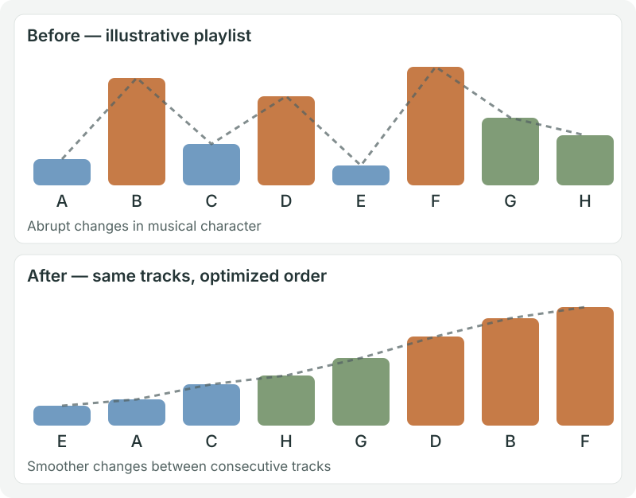
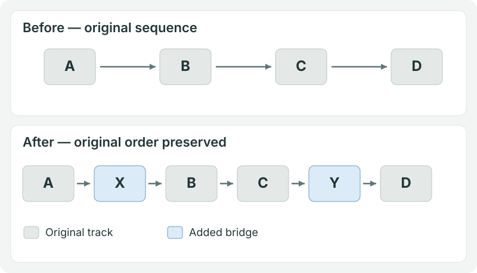

# Make your playlists flow

> "I love every song in this playlist, but somehow they don't work particularly well together in their current order."

A collection of favorite tracks can move abruptly between quiet, atmospheric songs and energetic ones. Better Call Bliss can help you find a more natural sequence, or keep your carefully chosen order and add suitable songs in between.

## Same songs, better flow

<figure class="guide-figure" markdown="1">

<figcaption>Simplified illustration using one hypothetical musical characteristic. Actual Bliss optimization considers multiple acoustic characteristics and configured constraints; this is not measured data, an actual result or a claim that Bliss sorts by energy.</figcaption>
</figure>

**What you need:** Bliss Mixer with completed analysis and [Better Call Bliss](https://github.com/chrober/lms-better-call-bliss). Material Skin is recommended but not required for the editor. No additional guidance plugin is necessary.

### Try it

1. Open **Extras → Better Call Bliss**.
2. Select a saved playlist.
3. Choose to optimize the track order without adding tracks.
4. Run **Preview**. Review the proposed order before making any change.
5. Save the result as a new playlist and listen to both versions.

Your original playlist remains intact unless you explicitly choose an available overwrite action. Repeat rules remain hard constraints; they can limit which solutions are possible. Your music files and Bliss analysis are not modified.

## Keep the order, smooth the gaps

Sometimes the order of your songs matters. Perhaps the first song sets the scene and the final one is a deliberate ending. Instead of rearranging them, let Better Call Bliss find bridging tracks that fit between the original songs.

<figure class="guide-figure" markdown="1">

<figcaption>Added songs are shown in blue; gray songs are your original choices. A bridge is an addition, not a replacement. Actual results depend on eligible tracks and constraints.</figcaption>
</figure>

### Try it

1. In the editor, select your source playlist.
2. Choose to preserve the existing order and add bridging tracks.
3. Let the plugin decide where additions are useful, or request a fixed number per gap.
4. Preview the new sequence. Check which songs were added, then save a separate copy.

You can also turn a short playlist into a longer listening session by choosing a supported track-count or duration target. Review the preview before applying it.

## Already listening?

Use a player queue snapshot as your source. Choose the upcoming portion and use **Replace upcoming tracks** when sending it back to the same player; this leaves the current track playing. Review the preview first. The three Material Skin **Bliss me there...** shortcuts are different: they run in the background and apply a successful, validated route automatically rather than asking you to approve an editor preview.

!!! tip "Give forgotten tracks a chance"
    [Library Signals](rediscover-your-music.md) can guide compatible playlist additions using your local listening history. Enable it in Better Call Bliss if you want this extra information to influence selection.

For exact options and available combinations, see [Better Call Bliss's documentation](https://github.com/chrober/lms-better-call-bliss).
