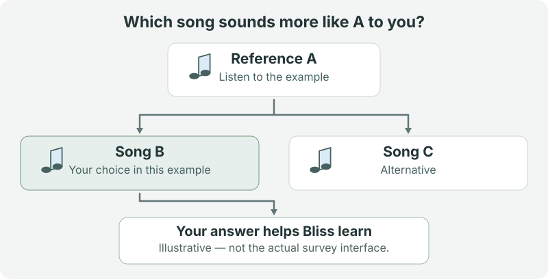

# Personalize your mixes

> "Bliss finds songs that sound similar, but some of its choices aren't what I would have picked."

Musical similarity is partly subjective. Perhaps you care more about the atmosphere of a recording than its pace. Bliss Mixer Lab lets you provide examples of what sounds similar to you and learn from your choices.

<figure class="guide-figure" markdown="1">

<figcaption>A simplified illustration of the learning principle, not the actual survey screen or an example of a measured learned model.</figcaption>
</figure>

## Teach Bliss your musical preferences

**What you need:** Bliss Mixer with a completed analysis and Bliss Mixer Lab.

1. Open the Lab settings and choose **Open Similarity Survey**.
2. Listen to the available examples and answer the comparisons according to your own sense of musical similarity.
3. Complete survey answers and use the training functionality to create a personal learned matrix.
4. In the Lab settings, review **Learned matrix influence** and use a supported Adaptive mixing strategy.
5. Try **Bliss (Lab)** DSTM or the Lab's **Create bliss mix (Lab)** action. Listen and compare with standard Bliss mixing.

The learned model influences how acoustic similarities are evaluated, rather than acting as a list of favorite songs. You can back up and restore your survey training data. If a training run fails, the previous learned matrix remains active.

## How much influence?

For Adaptive mixing with multiple seeds, **Learned matrix influence** blends learned similarity with the normal variance-based calculation. At 0% the multi-seed calculation uses variance only; at 100% it uses the learned matrix only. A single seed uses the valid learned matrix directly when applicable, rather than the multi-seed blend. Without a valid learned matrix, the host uses its normal fallback behavior.

Start with a moderate influence and listen to a few sessions before changing it again. The exact setting is a preference, not a quality score.

## Use your preferences in playlists, too

Better Call Bliss can also use the learned matrix from a compatible, enabled Bliss Mixer Lab installation. In a supported Adaptive playlist workflow, review the **Learned-matrix blend (%)** option and compare previews.

Better Call Bliss still works without the Lab or a trained matrix. Its supported Adaptive fallback uses variance for multi-track contexts and configured Static weights for a single-track context.

## Combine sound and other preferences

Learned similarity answers a different question from [Library Signals](rediscover-your-music.md), which can favor songs you have rarely played or recently added. [Last.fm Guidance](explore-musical-connections.md) adds musical relationships. You can combine supported options, but start with one change at a time to hear what each contributes.

The Lab is experimental; training does not guarantee that every future mix matches your taste. See the [Lab documentation](https://github.com/chrober/lms-blissmixer-lab) and [Better Call Bliss's options](https://github.com/chrober/lms-better-call-bliss/blob/main/ALGORITHMS.md) for precise compatibility and behavior.
