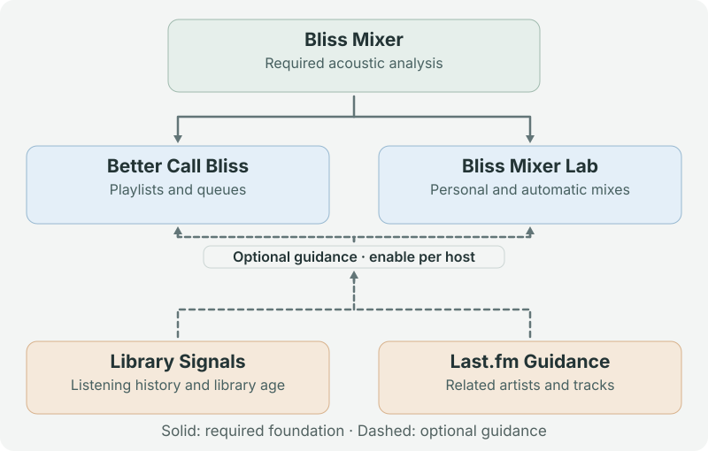

# Plugins and frequently asked questions

## The collection at a glance

<figure class="guide-figure" markdown="1">

<figcaption>Install what you need. The original Bliss Mixer remains available; guidance is optional and must be enabled in the playlist or mixing plugin.</figcaption>
</figure>

| Project | Start here |
| --- | --- |
| [Better Call Bliss](https://github.com/chrober/lms-better-call-bliss) | [Playlists](make-your-playlists-flow.md), [extension](extend-your-playlists.md), [queues](improve-your-player-queue.md), [musical routes](take-a-musical-journey.md) |
| [Bliss Mixer Lab](https://github.com/chrober/lms-blissmixer-lab) | [Continuous listening](keep-the-music-playing.md), [seasonal libraries](music-for-every-season.md), [personal preferences](personalize-your-mixes.md) |
| [Bliss Guidance: Library Signals](https://github.com/chrober/lms-guidance-library-signals) | [Rediscover your music](rediscover-your-music.md) |
| [Bliss Guidance: Last.fm](https://github.com/chrober/lms-guidance-lastfm) | [Explore musical connections](explore-musical-connections.md), [offline preparation](your-music-anywhere.md) |

## Frequently asked questions

### Do I need all four plugins?

No. Start with Bliss Mixer and its completed analysis. Choose Better Call Bliss for playlist and queue work, or Bliss Mixer Lab for automatic and experimental mixing. Add Library Signals or Last.fm Guidance only if you want those extra preferences.

### Will the Lab replace my original Bliss Mixer?

No. It runs alongside it and adds separate Lab actions and the Bliss (Lab) DSTM provider. You can switch back to standard Bliss.

### Why can't I find the plugins in Lyrion?

Check that the additional repository URL is entered in **Settings → Plugins**, apply the change and restart if requested. Confirm that your server platform and Lyrion version meet the plugin's requirements. See [installation](getting-started.md#install-the-collection).

### Why are my local songs not available for a Bliss mix?

Check that Bliss Mixer is enabled, its analysis has completed, and the music files are accessible to your server. Newly added music may need analysis. If a virtual library is selected, check that it contains suitable analyzed tracks.

### Why isn't my guidance plugin doing anything?

Installing a guidance provider alone is not enough. Enable it in the settings of Better Call Bliss or Bliss Mixer Lab. For the Lab, use a supported Bliss (Lab) DSTM workflow. Verify the provider's data source and preferences. Compare two previews or listening sessions with the guidance disabled and enabled; missing history or relationship information may contribute no preference. Guidance does not guarantee a particular track. For album and artist preferences, check the [required plugin versions and artist identity limitations](rediscover-your-music.md#what-you-need).

### Why can't I see or use Bliss me there...?

Those three shortcuts require Material Skin. Choose a local analyzed song or album and the appropriate player. The Extras editor works without Material Skin. See [Take a musical journey](take-a-musical-journey.md).

### Will optimizing a playlist change my music files?

No. Better Call Bliss does not modify audio files or the Bliss analysis. Editor jobs generate a read-only preview; you explicitly choose what to do with it. The destination shortcuts are different and apply a successful validated route automatically.

### Why couldn't a mix or playlist be completed?

A small candidate library, missing analysis, unavailable files, tight repeat windows, or strict route or duration constraints can limit the result. Check that the selected tracks and library are available and analyzed, review the diagnostics, and relax constraints only when that matches your listening goal. A failed route does not apply the proposed queue change.

### Why do I still hear songs outside my selected virtual library?

Changing the player's library restricts new candidates in supported workflows, not existing queue entries. Check the actual player library, the **Material player-library synchronization** mode, and any explicit Better Call Bliss candidate-library selection. See [the seasonal listening scenario](music-for-every-season.md).

If the Lab synchronization or queue-transfer controls are disabled, follow the link shown in Lab settings and disable Material's conflicting player-library setting. Return to Lab settings, choose the desired mode, save and reload your Material clients.

If Lab finds no new tracks after switching to a very different library, check **Relax seed genre restriction after a player library change**. It allows one retry without the genre restriction derived from the existing songs, while preserving the selected library and other filters.

### Can I use the plugins without the internet?

Local music, analysis, listening history and supported learned preferences can be used without internet access after preparation. Optional Last.fm acquisition needs connectivity; previously stored artist relationships can be reused where available. See [Your music, anywhere](your-music-anywhere.md).

### Which Lyrion versions are supported?

Developed and tested with Lyrion 9.1; older versions may work but have not been tested. Check each repository for exact requirements and platform-specific packages. The [plugin feed](https://github.com/chrober/lms-plugins) supplies the appropriate packages where available.

## Related projects and credits

This collection builds on [Lyrion Music Server](https://lyrion.org/), [Bliss Mixer](https://github.com/CDrummond/lms-blissmixer) by Craig Drummond and the underlying Bliss technology. Material Skin and the other community projects make many of the listening experiences possible.

For server platforms, mobile players, network bridges, controllers and optional plugins, see [Build your Lyrion setup](getting-started.md). Each linked repository has its own license, documentation and support channels.

## Report a problem

Use the relevant plugin repository's Issues page. Include your Lyrion and plugin versions, server platform, the steps you took, relevant settings and sanitized diagnostics. Do not share private library information, addresses or API keys. For questions about the plugin feed or this guide, use [lms-plugins](https://github.com/chrober/lms-plugins/issues).
