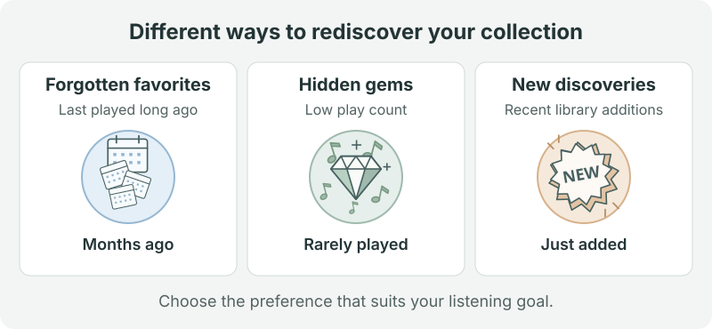
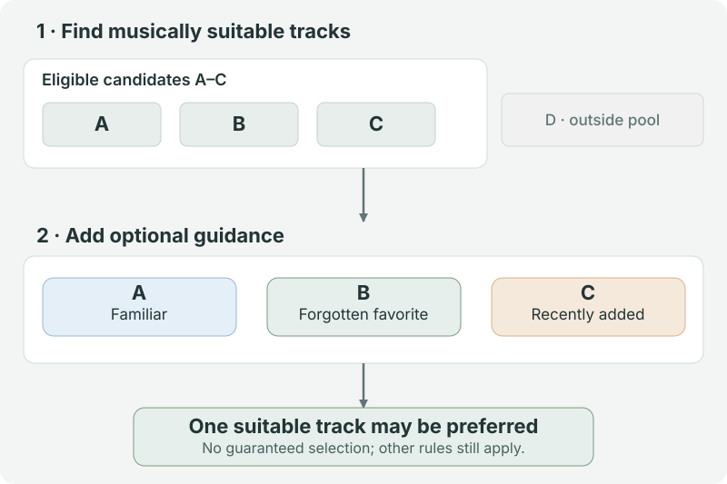

# Rediscover the music you own

> "I've collected music for years, yet I feel like I'm always listening to the same small part of it."

There may be a song that brings back a memory, an album you've hardly played, or a new release you've added but not yet heard. **Library Signals** can help compatible Bliss plugins give these songs more opportunities to appear.

<figure class="guide-figure" markdown="1">

<figcaption>Three ways to look at your own collection. The examples are illustrative, not measurements from a real library.</figcaption>
</figure>

## Three different ways to rediscover music

| If you feel like… | Configure Library Signals to prefer… |
| --- | --- |
| Hearing forgotten favorites | Tracks whose last-played date is further in the past |
| Giving hidden gems a chance | Tracks with a lower play count |
| Exploring the albums you've just added | Recently added tracks |

You can also prefer frequently or recently played tracks, or older library additions. Choose a direction that suits your listening goal.

## What you need

- Bliss Mixer with completed library analysis.
- [Bliss Mixer Lab](https://github.com/chrober/lms-blissmixer-lab) for Don't Stop the Music mixes, or [Better Call Bliss](https://github.com/chrober/lms-better-call-bliss) for supported playlist and queue workflows.
- [Bliss Guidance: Library Signals](https://github.com/chrober/lms-guidance-library-signals), enabled separately in the host you use.

Library Signals reads native Lyrion listening data by default. If you use [Alternative Play Count](https://github.com/AF-1/lms-alternativeplaycount), you can select its history as an alternative for play counts and last-played dates; library age still comes from Lyrion. No additional online service is needed. Missing data is treated neutrally, not as evidence that a track was never played.

## Try a rediscovery session

1. [Install the plugins](getting-started.md#install-the-collection).
2. Open the **Library Signals** settings and configure the last-played preference to favor music you haven't heard in a long time.
3. Open the **Bliss Mixer Lab** settings, enable Library Signals and review any host-specific overrides.
4. Select **Bliss (Lab)** as the Don't Stop the Music provider and start with a song you feel like hearing.
5. Let the session continue, then compare it with a session without the provider enabled.

Try the other signals in the same way. Start with one preference rather than changing everything at once.

## What changes — and what doesn't?

<figure class="guide-figure" markdown="1">

<figcaption>Library Signals favors suitable choices; it does not force any particular track to appear.</figcaption>
</figure>

Bliss still chooses from acoustically suitable local music and respects the host's constraints. Library Signals adds preferences among those eligible tracks. It does not create mixes by itself, introduce otherwise ineligible songs, or override repeat rules.

## Try it with playlists, too

Enable Library Signals in Better Call Bliss and preview a playlist or queue optimization. For example, extend a familiar playlist with suitable tracks that you rarely play. Where supported, host or job settings can override the provider's defaults.

[Make your playlists flow →](make-your-playlists-flow.md)

## More than just listening

Seeing the album cover, artist name or forgotten song title can make rediscovery even more enjoyable. [Lyrion Display](https://github.com/chrober/lyrion-display) is an optional dedicated fullscreen Now Playing display for compatible Android and Fire TV devices. It uses Material Skin and works independently of the music-selection extensions. Control your player with your usual controller; the display is read-only.

Read more about [Library Signals](https://github.com/chrober/lms-guidance-library-signals) and [the Bliss-first principle](understanding-bliss.md#sound-first-additional-knowledge-second).
