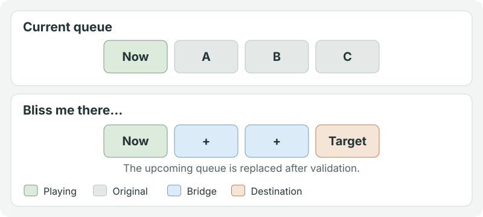
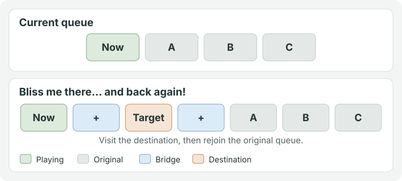
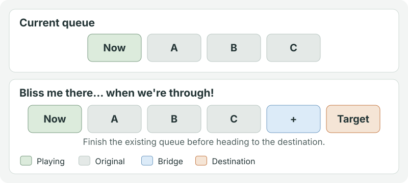

# Take a musical journey

> "I'm enjoying this song, but I suddenly feel like hearing a particular album. Can I get there without a jarring change?"

Instead of jumping directly from one musical world into another, let Better Call Bliss find a route through your local music. You choose the destination; the plugin looks for suitable connecting tracks.

**What you need:** Bliss Mixer with completed analysis, Better Call Bliss and Material Skin. Select the intended player with music in its queue, then open the context menu of a local song or album.

## Bliss me there...

Replace what's coming up with a route from the current song to your chosen destination.

<figure class="guide-figure" markdown="1">

<figcaption>Your current track continues. The original upcoming queue is replaced only if the new route succeeds and its live queue anchors are still valid.</figcaption>
</figure>

Choose **Bliss me there...** when your listening plans have changed and you want to head directly toward the new destination.

## Bliss me there... and back again!

Take a detour without losing your original queue.

<figure class="guide-figure" markdown="1">

<figcaption>The selected destination is a visit. The first originally upcoming track is the rejoin point; the rest of the queue stays in its original order.</figcaption>
</figure>

Choose **Bliss me there... and back again!** when you want to hear something particular, then return to what you had planned. This requires an upcoming track to return to.

## Bliss me there... when we're through!

Finish the music that is already queued, then head toward the destination.

<figure class="guide-figure" markdown="1">

<figcaption>The last track of the existing queue is the departure point. The current queue stays in place.</figcaption>
</figure>

Choose **Bliss me there... when we're through!** when you are happy with the current queue but already know what you want to hear afterwards.

## What happens behind the scenes?

These three Material Skin shortcuts use the saved route settings and run as background jobs. Unlike the playlist editor, they apply a successful result automatically, after checking the relevant live queue anchors. You can see progress and errors under **Running and recent previews** in Better Call Bliss.

An album is treated as a complete destination in disc and track order. The plugin does not rearrange its tracks or insert bridges inside it; it finds a way to its first track and, for the detour, a way back from its last track. All destination tracks must be local and resolved through Bliss.

The diagrams show possible routes, not guaranteed numbers of intermediates. Depending on your settings and the music, a suitable route may need no bridges, several, or may not be feasible. Repeat rules and your selected candidate library still matter. If the job fails or queue validation fails, it does not apply the proposed route.

!!! tip "Choose the action, not the algorithm"
    Start with the saved defaults. You can later change the number of intermediate tracks or automatic route settings on the Better Call Bliss settings page. The detour uses one shared intermediate-track budget for both legs.

[Improve your player queue manually](improve-your-player-queue.md) · [Explore Last.fm guidance](explore-musical-connections.md)

For details, see [the route documentation](https://github.com/chrober/lms-better-call-bliss/blob/main/ALGORITHMS.md#bliss-me-there).
