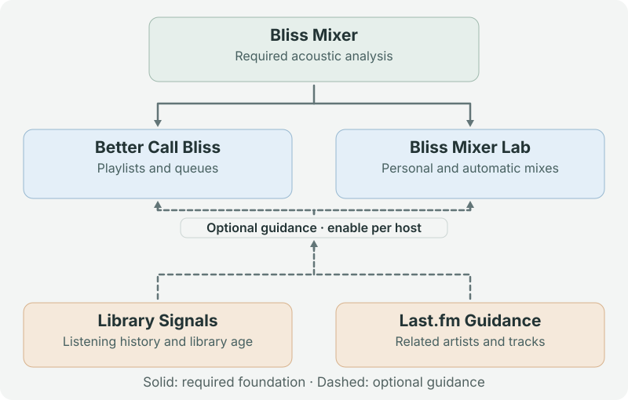
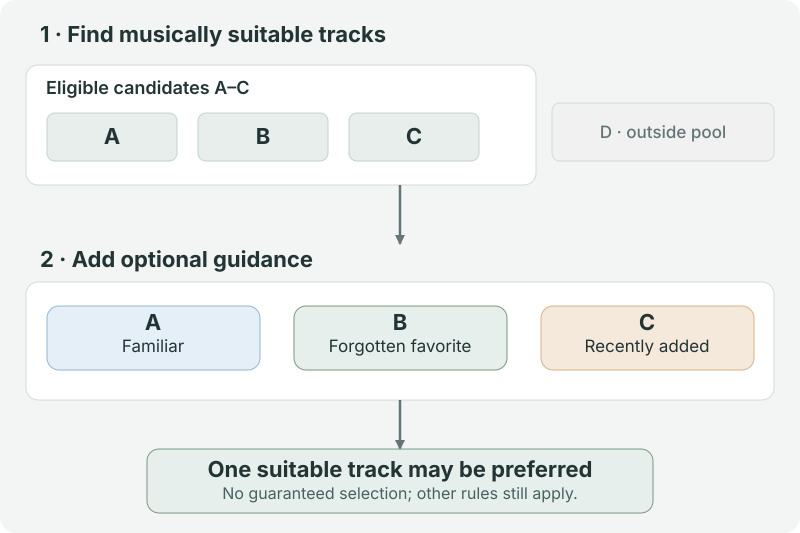

# Understanding Bliss

Think about two songs that sound as though they belong together. They might share a pace, atmosphere, instrumentation or other musical characteristics — even when they're by different artists.

[Bliss Mixer](https://github.com/CDrummond/lms-blissmixer), by Craig Drummond, analyzes your local music and uses that analysis to find acoustically similar tracks. It already creates mixes from your library. The extensions in this collection use that foundation to explore more ways of choosing and arranging music.

## One foundation, different ways to listen

<figure class="guide-figure" markdown="1">

<figcaption>The two main plugins work independently. Guidance plugins add information to a compatible host, not another playback engine.</figcaption>
</figure>

| Plugin | What it does for you |
| --- | --- |
| [Bliss Mixer](https://github.com/CDrummond/lms-blissmixer) | Creates sound-based mixes and provides the analysis required by the two extensions. |
| [Better Call Bliss](https://github.com/chrober/lms-better-call-bliss) | Improves saved playlists and queues, inserts or adds suitable tracks, and creates musical routes. |
| [Bliss Mixer Lab](https://github.com/chrober/lms-blissmixer-lab) | Offers experimental mixing, personal preference learning and the separate Bliss (Lab) Don't Stop the Music option. |
| [Library Signals](https://github.com/chrober/lms-guidance-library-signals) | Gives a compatible host additional knowledge from your play counts, last-played dates and library age. |
| [Last.fm Guidance](https://github.com/chrober/lms-guidance-lastfm) | Adds Last.fm similar-artist and similar-track knowledge to supported selection workflows. |

Don't Stop the Music (DSTM) is Lyrion's way of choosing more tracks when your current queue needs continuing. The Lab adds its own provider without replacing the original Bliss provider. You can try it and return to your usual choice.

## Sound first, additional knowledge second

Imagine that Bliss finds several songs which would fit your current music. Perhaps one is a forgotten favorite, one is a new arrival and one is an artist you play frequently. Acoustic suitability still matters; optional guidance helps choose among the songs that are eligible.

<figure class="guide-figure" markdown="1">

<figcaption>Illustrative decision flow, not a score or guaranteed outcome. Repeat rules and other constraints still apply.</figcaption>
</figure>

The guidance plugins do not play songs on their own or override repeat rules. Install and explicitly enable them in Better Call Bliss or Bliss Mixer Lab. For the Lab, additional guidance applies to its supported DSTM workflow; do not assume every Lab menu action uses it.

## Do I need the whole collection?

No. Choose Better Call Bliss for playlist and queue work, or Bliss Mixer Lab for automatic and experimental mixing. Add either guidance provider if you want its information to influence music selection. The two main plugins can work without one another or a learned preference matrix.

The acoustic analysis stays on your server. Library Signals uses local listening data. Last.fm information is optional and may involve online queries; the API Key source can also retain artist relationships locally. Offline preferred is not a strict offline-only guarantee.

[Build your Lyrion setup →](getting-started.md) · [Try a playlist →](make-your-playlists-flow.md)
