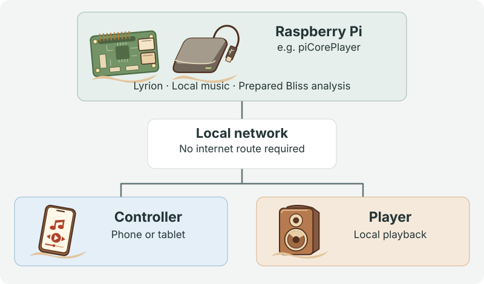
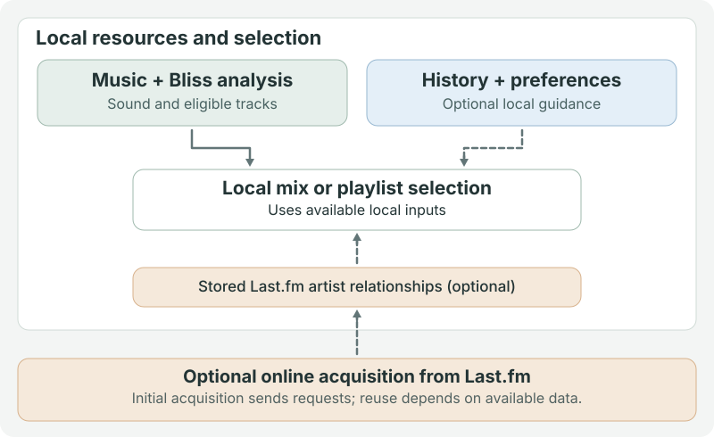

# Your music, anywhere, under your control

> "I want to take my music with me. I don't want good listening to depend on a working internet connection."

Your own library has an advantage: it can travel with you. Lyrion and Bliss Mixer can turn a small computer into a local music system, and the extensions can build on the music and knowledge you already have.

## A small music server, not a cloud service

<figure class="guide-figure" markdown="1">

<figcaption>One possible compact setup. A local network can connect your devices even when the internet is unavailable.</figcaption>
</figure>

The extensions have been tested by the author on a Raspberry Pi 4. [piCorePlayer](https://www.picoreplayer.org/) is a convenient server and/or player platform for a Raspberry Pi. You can also use another compatible Lyrion installation; you don't need to migrate a working setup.

Bring a small server, power supply, locally accessible music and a suitable local network and player. For example, take them to a holiday apartment, a campervan or somewhere with unreliable internet. Your existing equipment may be usable through the [player options](getting-started.md#your-players), subject to its own connectivity and compatibility requirements.

Performance depends on library size, analysis, storage and workload; the Raspberry Pi example is a tested configuration, not a guarantee for every setup.

## Keep the music knowledge with you

<figure class="guide-figure" markdown="1">

<figcaption>The local path does not require an external recommendation service. Last.fm acquisition is a separate optional online activity.</figcaption>
</figure>

Once your system is prepared, the following can remain available locally:

| Local resource | What it makes possible |
| --- | --- |
| Music files and completed Bliss analysis | Sound-based mixes, playlist reordering, additions and routes |
| Track, album and artist listening history, plus library age | Library Signals-guided rediscovery using local data |
| Optional learned preferences | Personal Adaptive similarity where supported |
| Previously acquired Last.fm artist relationships | Optional partial artist guidance, subject to availability and policy |

Before leaving home, install the plugins, complete Bliss analysis and check that your music is truly accessible without the internet. A NAS at home will not be reachable from your holiday setup merely because the files are in your library. Copy the music you need to storage available at the destination and prepare the analysis for that accessible library.

## Privacy at home

If you prefer a local-only system, the same approach works at home. Local acoustic analysis, local library history and local selection do not inherently need to send your track or artist queries to online services.

For a firm no-internet setup, block internet access at the network level while allowing your server and controllers to communicate locally. A LAN with no internet route is not necessarily a physical air gap. Disable or avoid online services such as remote metadata lookups, scrobbling and live streaming where appropriate; other plugins and devices may have their own network behavior. Check artwork availability locally as well.

This is control over your setup, not a promise that all Lyrion components, applications or receiving devices are automatically private or work offline.

## Optional Last.fm knowledge without continuous connectivity

If you enjoy Last.fm guidance, you can prepare some artist information before a trip.

1. While online, configure the [Last.fm provider](explore-musical-connections.md) with its **API Key** source and a valid key.
2. Choose the desired artist collection scope and settings. Click **Update offline Last.fm library** and monitor coverage and progress.
3. Select **Offline preferred** and enable Last.fm Guidance in Bliss Mixer Lab and/or Better Call Bliss, wherever you plan to use it.
4. Disconnect internet access and test the intended playback and mixing workflow before leaving.

The initial acquisition sends requests to Last.fm. Previously stored artist relationships can be reused; missing or expired data may mean partial or neutral guidance. Track relationships use a separate short-lived cache. **Offline preferred is not strict offline-only** and may use the internet if available. To ensure no requests leave your setup, enforce network isolation or disable Last.fm guidance.

The API Key source's retained data is subject to Last.fm's API terms and the provider's storage limits. The LastMix source does not maintain this local artist store. See [Last.fm Guidance](https://github.com/chrober/lms-guidance-lastfm#optional-keep-artist-similarities-for-offline-listening) for preparation and maintenance details.

## Before you leave

!!! tip "Your offline listening checklist"
    - Check your music files, Bliss analysis and plugin installations while the internet is disconnected.
    - Check the local network, power supply and your preferred controller and player.
    - Try a playlist preview and Bliss (Lab) DSTM with the library you will take.
    - If you want personal or Last.fm guidance, prepare it before departure.
    - Back up important settings, training data and music.

A compatible Android tablet or Fire TV with [Lyrion Display](https://github.com/chrober/lyrion-display) can show what's playing on your local system using Material Skin. It is an optional read-only companion, not a player or mixing requirement.

The local server and playback foundation come from Lyrion; local acoustic analysis comes from Craig Drummond's Bliss Mixer and the underlying Bliss technology. These extensions add more ways to enjoy that foundation.
